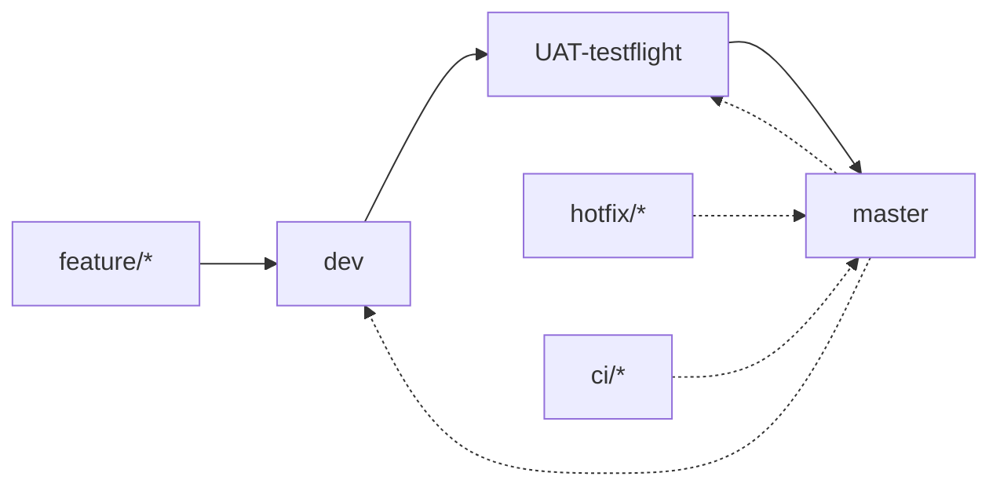

# studyApp

A SwiftUI iOS app for social study tracking, a focus timer and study groups. It uses MVVM with SwiftData for persistence.

## Requirements

- Xcode 26 or later
- Deployment target: iOS 26.0
- Bundle ID: `personal.studyBud`

## Build and run

Build for the simulator:

```bash
xcodebuild build -project studyApp.xcodeproj -scheme studyApp -destination generic/platform=iOS
```

Run the tests:

```bash
xcodebuild test -project studyApp.xcodeproj -scheme studyApp
```

For building and installing on a device, see the [Quick Start in CLAUDE.md](CLAUDE.md#quick-start).

## Branches and releases



`dev` builds go to TestFlight internal (Self). `UAT-testflight` builds go to TestFlight external (UAT). `master` builds only on a `v*` tag, which goes to TestFlight external (Stable) and then App Store review.

See [pipeline.md](pipeline.md) for the full flow, and its [Procedures](pipeline.md#procedures) for step-by-step promotions.

## Documentation

| File | What it covers |
| --- | --- |
| [pipeline.md](pipeline.md) | Branch flow, releases, hotfixes and CI maintenance |
| [CLAUDE.md](CLAUDE.md) | Conventions for contributors and agents: architecture, layer rules, git workflow |
| [.github/workflows/README.md](.github/workflows/README.md) | GitHub Actions workflows and their triggers |
| [docs/AppOverview.md](docs/AppOverview.md) | App structure, features and navigation |
| [docs/AppSettings.md](docs/AppSettings.md) | App settings, environment injection and themes |
| [docs/HowToTestSwiftData.md](docs/HowToTestSwiftData.md) | Testing SwiftData models and ViewModels with in-memory containers |
| [docs/SwiftDataImplementation.md](docs/SwiftDataImplementation.md) | Historical SwiftData migration plan |
| [todos/engineering-todo.md](todos/engineering-todo.md) | Deferred engineering and UI decisions from code review |
| [todos/ui-design-ideas.md](todos/ui-design-ideas.md) | UX and design ideas, including the pause/break button |

## Contributing

- Branch off `dev` using `type/short-slug`, for example `feat/sub-timer` or `fix/crash-on-launch`.
- Write commits and PR titles in [Conventional Commits](https://www.conventionalcommits.org/) form, `type(scope): description`.
- Merge commits only: `UAT-testflight` and `master` accept PRs merged with **Create a merge commit**.
- Full rules are in [CLAUDE.md's Git Workflow](CLAUDE.md#git-workflow).
