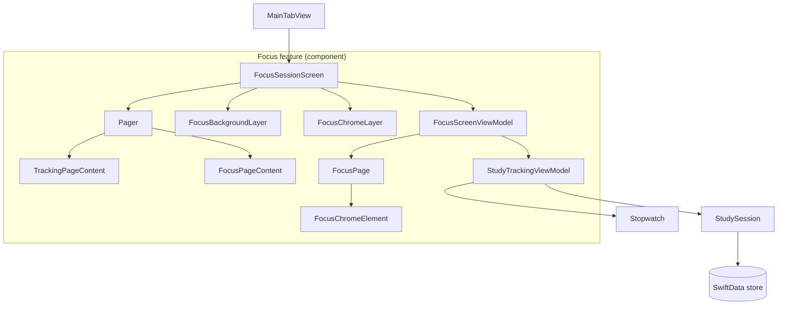

# Focus Screen Architecture — Proposal

**Status:** proposal / write-up only. No Swift source was changed on this branch.
**Branch:** `docs/focus-screen-modularity` (forked from `feat/studyItems`)
**Code read at:** `f9899d5` — line numbers below refer to that commit and will drift.
**Scope:** `Views/Focus/*`, `StudyTrackingViewModel`, and how they fit together.

---

## TL;DR

1. **The pager is a paging `ScrollView`, not a `TabView`.** The right tool for "bind it to an enum" is therefore `.scrollPosition(id:)`, not `TabView(selection:)`. The app already does the `TabView` version of this correctly: `AppTab` + `AppSession` in `MainTabView`. Mirror that.
2. **Replace every page index with a `FocusPage` enum**, and derive the page list from state (`availablePages`) instead of hard-coding `0..<2`. Indices can't be removed from the *continuous* crossfade maths, but they can be quarantined into one function.
3. **Yes, add a small view model: `FocusScreenViewModel`.** It owns navigation/presentation state (current page, scroll progress, which chrome is hidden). `StudyTrackingViewModel` stays the session domain. This mirrors the `AppSession` precedent and makes the logic unit-testable.
4. **"Core chrome" = a `FocusChromeElement` enum + a per-page `hiddenChrome` table.** Not preferences, not environment — a plain exhaustive `switch`. Adding a screen becomes: add a case, let the compiler list what's missing.
5. **Do not restructure yet.** Phase 1 (enum + VM) is behaviour-preserving. Moving the header into the shell and extracting layer structs (Phase 2/3) should follow the C4 diagram, not precede it, so the boxes you draw are the boxes you then build.
6. **Variable ordering:** pick one convention and apply it everywhere — proposed in [§4](#4-declaration-order-variables--derived--body). Today the two page files and the shell each use a different order.
7. **There is a genuine disagreement between sources** about computed-property subviews vs. separate `View` structs. [§5](#5-computed-properties-vs-separate-structs) gives a concrete rule for this codebase rather than picking a side by decree.

---

## 1. Where the logic depends on an index or a count today

Everything below is behaviour that is currently tied to "there are exactly two pages, and they are 0 and 1", or to ad-hoc booleans that disagree with each other.

| # | Location | What it assumes | Problem |
|---|---|---|---|
| 1 | `FocusPagerLayout.swift:19-20` | `trackingPage = 0`, `focusPage = 1` | Magic indices; a third page means renumbering by hand |
| 2 | `FocusSessionScreen.swift:197-198` | `ForEach(0..<2)` and `page == trackingPage ? 1 - pageBlend : pageBlend` | Page count and the "two-way blend" are hard-coded |
| 3 | `FocusSessionScreen.swift:64-67` | `pageBlend` is 0 → tracking, 1 → focus | Only expresses a blend between exactly two things |
| 4 | `FocusSessionScreen.swift:96` | `min(max(travelled / width, 0), 1)` | The `1` is "last page index" — silently wrong with 3 pages |
| 5 | `FocusSessionScreen.swift:77` vs `:155` | Pager shows the focus page when `vm.sessionIsRunning` (`activeSession != nil`, i.e. running **or paused**); dots show only when `currentSessionState` is `.sessionRunning` | Two different definitions of "there's a second page". While **paused**, you can swipe to the focus page but get no dots. May be intentional — worth deciding explicitly |
| 6 | `TrackingPageContent.swift:26,70` | `@State currentStudySessionInProgress = false`, never written | The subject picker is *always* enabled. And because it binds `Bindable(vm).selectedSubject` directly, it bypasses the `guard activeSession == nil` inside `updateSubjectSelection(_:)` |
| 7 | `FocusPageContent.swift:60` | The tab-bar hide lives inside one page | Chrome visibility is decided by page content rather than by the screen |
| 8 | `FocusPageContent.swift:101-126` | `mainButtonSymbol`, `mainButtonLabel`, `performMainAction` | Not referenced from `body` — appears to be dead code duplicating `TrackingPageContent` |

Items 5 and 6 are the clearest examples of the principle you stated: *the same fact ("is a session active?") is derived in three different places, two of which are wrong or unwired.* The fix is one derived property, read everywhere.

---

## 2. Proposal A — enum-driven pages and a screen view model

### 2.1 The enum

```swift
// ViewModels/Focus/FocusPage.swift
enum FocusPage: CaseIterable, Identifiable {
    case tracking
    case focus

    var id: Self { self }

    var hiddenChrome: Set<FocusChromeElement> {
        switch self {
        case .tracking: []
        case .focus: [.totalTime]
        }
    }
}
```

No `Int` raw value on purpose: the moment a case has a raw value, someone writes `FocusPage(rawValue: 1)` and you are back to indices. Position is *derived* from `availablePages`, never stored.

Per `CLAUDE.md`, ViewModels don't import SwiftUI. This file doesn't need to — it's plain Swift. The repo's `.swiftlint.yml` enforces that for `ViewModels/` and `Models/`.

### 2.2 The view model

```swift
// ViewModels/Focus/FocusScreenViewModel.swift
import Observation

@Observable
final class FocusScreenViewModel {
    let tracking: StudyTrackingViewModel

    var scrolledPage: FocusPage? = .tracking
    var pageProgress: Double = 0

    init(tracking: StudyTrackingViewModel = StudyTrackingViewModel()) {
        self.tracking = tracking
    }

    var availablePages: [FocusPage] {
        tracking.sessionIsRunning ? [.tracking, .focus] : [.tracking]
    }

    var currentPage: FocusPage {
        guard let page = scrolledPage, availablePages.contains(page) else { return .tracking }
        return page
    }

    var isPagingEnabled: Bool { !tracking.focusLockEnabled }

    var hiddenChrome: Set<FocusChromeElement> {
        var hidden = currentPage.hiddenChrome
        if tracking.focusLockEnabled { hidden.insert(.tabBar) }
        return hidden
    }

    func weight(of page: FocusPage) -> Double {
        guard let index = availablePages.firstIndex(of: page) else { return 0 }
        return max(0, 1 - abs(pageProgress - Double(index)))
    }

    func opacity(of element: FocusChromeElement) -> Double {
        availablePages
            .filter { !$0.hiddenChrome.contains(element) }
            .reduce(0) { $0 + weight(of: $1) }
    }
}
```

Design notes, each of which is a deliberate choice:

- **`scrolledPage` is optional, `currentPage` is not.** `scrollPosition(id:)` requires an optional binding (it is `nil` before the first layout pass). `currentPage` wraps it so no other code ever sees `nil`.
- **`currentPage` re-validates against `availablePages`.** Today, ending a session while on the focus page works only because the `ScrollView` clamps its offset when the second page disappears. With an enum binding you would otherwise hold a stale `.focus` pointing at a page that no longer exists. Deriving `currentPage` instead of resetting it in an `onChange` means there is no moment where the state is wrong.
- **`weight(of:)` is the *only* place that touches an index.** Page `i` is "fully shown" when `pageProgress == Double(i)` and fades linearly to the neighbours. Weights across all pages sum to 1, which is exactly what the crossfades need. This replaces `pageBlend`, the `1 - pageBlend` special case, and the `0..<2` loop.
- **`hiddenChrome` vs `opacity(of:)`.** `hiddenChrome` answers settled-state questions (should the tab bar exist? should this element take hits?). `opacity(of:)` answers continuous ones (how faded is this mid-swipe?). Both read from the same `hiddenChrome` table on `FocusPage`, so they cannot disagree.
- **`focusLockEnabled` stays in `StudyTrackingViewModel` for now** because `endSession` and `cancelActiveSession` reset it. See [open decisions](#9-open-decisions).
- **Actor isolation:** the target sets `SWIFT_DEFAULT_ACTOR_ISOLATION = MainActor`, so the explicit `@MainActor` that the SwiftUI review guidance normally asks for on `@Observable` classes is already implied.

### 2.3 The pager

```swift
private var pager: some View {
    @Bindable var screen = screen

    return ScrollView(.horizontal) {
        HStack(spacing: 0) {
            ForEach(screen.availablePages) { page in
                pageView(for: page)
                    .containerRelativeFrame(.horizontal)
            }
        }
        .scrollTargetLayout()
    }
    .scrollPosition(id: $screen.scrolledPage)
    .scrollTargetBehavior(.paging)
    .scrollIndicators(.never)
    .scrollBounceBehavior(.basedOnSize)
    .scrollDisabled(!screen.isPagingEnabled)
    .onScrollGeometryChange(for: Double.self) { geometry in
        guard geometry.containerSize.width > 0 else { return 0 }
        return Double((geometry.contentOffset.x + geometry.contentInsets.leading) / geometry.containerSize.width)
    } action: { _, progress in
        screen.pageProgress = progress
    }
}

@ViewBuilder
private func pageView(for page: FocusPage) -> some View {
    switch page {
    case .tracking: TrackingPageContent(vm: screen.tracking)
    case .focus: FocusPageContent(vm: screen.tracking)
    }
}
```

What changed relative to today:

- The `if vm.sessionIsRunning { FocusPageContent… }` becomes data (`availablePages`), so the dots, the pager, and the clamp can't disagree about the count.
- The `min(max(…, 0), 1)` clamp disappears: `weight(of:)` already returns 0 outside range, and an unclamped progress is harmless.
- `pageView(for:)` is an **exhaustive `switch`** — adding `case .stats` to `FocusPage` produces a compile error here (and in the `hiddenChrome` switch) until it's handled. That is the "easy to add screens" mechanism: the compiler holds the to-do list.
- Programmatic navigation is now one line: `withAnimation { screen.scrolledPage = .focus }`, e.g. when a pure-focus session starts.

### 2.4 Page indicator and backgrounds read weights, not indices

```swift
HStack(spacing: 6) {
    ForEach(screen.availablePages) { page in
        Circle()
            .fill(.white)
            .opacity(0.35 + 0.65 * screen.weight(of: page))
            .frame(width: 6, height: 6)
    }
}
```

```swift
ZStack {
    ForEach(screen.availablePages) { page in
        background(for: page)
            .opacity(screen.weight(of: page))
    }
}
.ignoresSafeArea()
```

**Reduce Motion** stays a view concern (it comes from `@Environment`). The current code snaps to the nearest page; the equivalent is to substitute `weight(of:)` with `1`/`0` based on which page is nearest. Keep that substitution in the one small struct that renders weights so it isn't copy-pasted.

### 2.5 Tests

This is the practical payoff of the view model. The existing `AppSessionTests` use Swift Testing; these would match:

```swift
struct FocusScreenViewModelTests {

    @Test("Only the tracking page exists before a session starts")
    func trackingOnlyBeforeSession() {
        #expect(FocusScreenViewModel().availablePages == [.tracking])
    }

    @Test("Page weights sum to 1 at any scroll progress", arguments: [0.0, 0.25, 0.5, 0.9, 1.0])
    func weightsSumToOne(progress: Double) throws {
        let container = try ModelContainer(
            for: StudySession.self, Subject.self,
            configurations: ModelConfiguration(isStoredInMemoryOnly: true)
        )
        let screen = FocusScreenViewModel()
        screen.tracking.startSession(ctx: container.mainContext)
        screen.pageProgress = progress

        let total = screen.availablePages.map(screen.weight(of:)).reduce(0, +)
        #expect(abs(total - 1) < 0.0001)
    }
}
```

Starting a session needs an in-memory `ModelContainer` (the same trick the existing `#Preview` uses). That's one more reason to keep `tracking` injectable through `init`.

### 2.6 Note on the other paged row

`HorizontalContentScrollRow` is a real `TabView(.page)` with two pages (media, leaderboard) and **no selection binding**. If any logic ever needs to know which one is showing, give it the same treatment as `AppTab`: an enum, `Tab(value:)`/`.tag`, and a selection binding. Not needed today; flagged so it isn't done with an `Int`.

---

## 3. Proposal B — a modular "chrome + pages" focus screen

### 3.1 What the code does today

The shell already has the right *idea*: the timer and backgrounds are siblings of the pager, so they can't drift when you swipe. The cost is a handshake between three files:

```
FocusSessionScreen.pinnedTimerLayer   ──┐  must agree on
FocusPagerLayout.headerSlotHeight (96) ─┼─ position, by convention
TrackingPageContent / FocusPageContent ─┘  (each leaves a 96pt gap + a PinnedTimerSlot)
```

and two more coupled constants: `timerFontSize = 90` in the shell and `slotHeight = 120` in `PinnedTimerSlot`, tied together only by a comment ("sized off the same @ScaledMetric base").

Every new page has to know the header height, add the slot, and remember its own horizontal padding. That is what makes adding a screen feel heavy.

### 3.2 Target model

```
FocusSessionScreen (shell — composition root)
├── Background layer        weights of pages → gradients
├── Chrome layer            subject selector · total · timer · page dots
└── Pager                   one view per FocusPage, laid out below the chrome
        ├── TrackingPageContent
        └── FocusPageContent  (+ future pages)
```

Pages stop knowing chrome exists. The shell tells the pager how much room the chrome takes; the pages just fill what's left.

### 3.3 The chrome element table

```swift
enum FocusChromeElement: Hashable {
    case subjectSelector
    case totalTime
    case timer
    case tabBar
}
```

Initial values, derived from what the two pages actually differ on today:

| Element | tracking | focus | Notes |
|---|---|---|---|
| `subjectSelector` | shown | shown | Focus currently shows the bare subject *code* at 35pt instead of the picker; unify as a disabled picker during a session, or keep a compact variant — see open decisions |
| `totalTime` | shown | **hidden** | Top-right "Total" is currently only on the tracking page |
| `timer` | shown | shown | |
| `tabBar` | shown | hidden **while locked** | Locking is state, not page — handled in `FocusScreenViewModel.hiddenChrome` |
| page dots | — | — | Derived: `availablePages.count > 1`, not a table entry |

The core elements (`subjectSelector`, `timer`) are simply never listed in any page's `hiddenChrome`. "Hide on a per-screen basis" is then a one-word diff in `FocusPage.hiddenChrome`.

### 3.4 Why a plain table and not preferences or environment

Three mechanisms could plausibly carry "this page wants to hide X". Only one fits.

| Mechanism | Direction | Fit |
|---|---|---|
| `@Environment` / `@Entry` | parent → child | **Wrong direction.** Chrome sits above the pages; it would need info flowing *up* |
| `PreferenceKey` (what `navigationTitle` and `preferredColorScheme` use) | child → parent | Right direction, but preference values are collected from **every** child in the hierarchy. The pager's `HStack` is non-lazy, so off-screen pages contribute too. You'd then have to filter by current page — i.e. you'd need the table anyway, with extra indirection |
| Exhaustive `switch` on `FocusPage` (this proposal) | state → view | **Fits.** One place to read, compiler-checked, trivially unit-testable, no hidden data flow |

Preferences remain a good tool for *measuring* things upward (e.g. chrome height). For that specific job `onGeometryChange` — already used in `FocusPageContent.swift:195` — is the simpler modern replacement.

### 3.5 Letting pages start below the chrome without a magic number

Today: `headerSlotHeight = 96` plus `PinnedTimerSlot` in each page. Alternative: measure the chrome once and inset the pager.

```swift
@State private var chromeHeight: CGFloat = 0

pager
    .safeAreaPadding(.top, chromeHeight)

chromeLayer
    .onGeometryChange(for: CGFloat.self, of: { $0.size.height }) { chromeHeight = $0 }
    .allowsHitTesting(false)
```

This deletes `FocusPagerLayout.headerSlotHeight`, `PinnedTimerSlot` in both pages, and the 90-vs-120 coupling. **It is a structural change** — flagged as Phase 2 below, deliberately not Phase 1.

---

## 4. Declaration order: variables → derived → body

### 4.1 What exists

Nothing authoritative prescribes this for SwiftUI — the Swift API Design Guidelines cover naming, not member order, and Apple's own sample code is informal. What does exist:

- **SwiftLint `type_contents_order`** (opt-in, `Enabled by default: No`) — the closest thing to a standard. Default order: cases → type aliases → subtypes → type properties → instance properties → initializers → type methods → lifecycle methods → other methods → subscripts → `deinit`. [Source](https://realm.github.io/SwiftLint/type_contents_order.html). Its own example places a SwiftUI `var body` after another `var`.
- **Community style guides** — e.g. a SwiftUI style guide on GitHub says computed properties should come last within a group of same-kind declarations; a Hacking with Swift forum answer suggests nested types first, then wrapped properties, then constants. *(I only read search excerpts of these two, not the full pages — treat as indicative.)*

Two consequences for you:

1. **The lint rule can't express "`@Environment` before `@State`"** — to it they're all instance properties. It can only enforce coarse groups.
2. **By my reading of the default order, it fits SwiftUI poorly.** All instance properties (stored *or* computed) sit above `init`, so private `var header: some View` helpers would have to be hoisted above the initializer. Most SwiftUI codebases put helpers below `body`. If you ever enable it, you'd need a custom `order`. This repo's `.swiftlint.yml` uses `only_rules`, so nothing changes unless added deliberately. **Recommendation: don't enable it; document the convention here instead.**

### 4.2 Proposed convention

Read top-to-bottom as a data pipeline: *what comes in → what's owned → what's derived → how it's drawn → what the user can do.*

```swift
struct SomeView: View {

    // 1. Nested types and constants
    private enum Layout { static let ringLineWidth: CGFloat = 8 }

    // 2. Inputs — what the parent must supply (matches the memberwise init and call site)
    let vm: StudyTrackingViewModel
    @Binding var selection: Subject?

    // 3. Environment
    @Environment(\.modelContext) private var modelContext
    @Environment(\.accessibilityReduceMotion) private var reduceMotion

    // 4. Owned state, then scaled metrics
    @State private var draftDuration: TimeInterval = 0
    @ScaledMetric(relativeTo: .largeTitle) private var timerFontSize: CGFloat = 90

    // 5. Derived values — plain computed properties, not views
    private var isSessionPaused: Bool { … }

    // 6. init (only if the memberwise one isn't enough)

    // 7. body — the picture of the screen
    var body: some View { … }

    // MARK: - Sections   (in the order they appear on screen)

    // MARK: - Actions    (private funcs; Button actions call these)
}

#Preview { … }
```

Why this order, specifically:

- **Inputs first** because they are the view's public API and the synthesized memberwise init follows declaration order — keeping inputs together and in call-site order means the init and every call site read the same way.
- **Derived values before `body`** so that when you reach `body` every name it uses has already been introduced. You read "what are the facts" before "how are the facts drawn".
- **`body` before helpers** because the most important member of a view should be the first thing you see after its data. This is the one place I'm deviating from a strict "declare everything before use" instinct: Swift has no declare-before-use rule, and readers scan for `body` first.
- **Actions last**, extracted as methods, so `body` shows layout and not logic (the SwiftUI review guidance is explicit that button actions and `onAppear` logic shouldn't be inline).
- **One type per file**, with `#Preview` at the bottom.

### 4.3 Today vs. the convention

| File | Current top-of-file order | Gaps |
|---|---|---|
| `FocusSessionScreen` | Environment → State (page offset) → ScaledMetric → init → body → `ticking` func → `pageBlend` → MARK sections | Derived `pageBlend` sits *after* `body` and between helpers; `ticking` (logic-ish container) is mixed in with layout |
| `TrackingPageContent` | `let vm` → Environment ×3 → Namespace → State → ScaledMetric → body → sections → action funcs mixed between sections | Inputs-first ✓. Actions are interleaved with subview properties (`performMainAction`, `withMorphAnimation` between `controlsSection` and `horizontalContentScrollRow`). `@State var onlineFriendCount` isn't `private` |
| `FocusPageContent` | `let vm` → Environment → `@State var selectedDuration` (non-private) → State → constants → body → actions → subviews | Subviews and actions in the opposite order to the other page; two unused/duplicated members (see §1 #8) |

None of this needs a rewrite — it's a "next time you touch the file" rule, applied when you're already editing it.

---

## 5. Computed properties vs. separate structs

This is the one place where sources conflict, so it deserves an explicit rule instead of a stance.

| Source | Position |
|---|---|
| This repo's `CLAUDE.md` | Decompose `body` with `private var` computed properties; extract a `private struct` when the component animates independently or is reused |
| Swift by Sundell (*Using multiple computed properties to form a body*) | Computed `some View` properties are a good lightweight alternative to separate types — no data to pass down, and the view stays one unit. Still split into types if you want reuse |
| SwiftUI review guidance (`swiftui-pro` skill) | Strongly prefer separate `View` structs; `@ViewBuilder` on a property doesn't change that. Reason: a struct with unchanged inputs can be skipped by SwiftUI's diffing, whereas a computed property is re-evaluated whenever the parent's `body` is |

They are reconcilable once you notice *when* the performance argument bites: when the parent re-evaluates often. On this screen that's real — the shell holds a `TimelineView` ticking every 0.5s and a scroll-progress value that changes every frame while dragging.

**Rule for this codebase** (a recommendation — adjust it freely):

> Use a `private var … : some View` when the fragment is pure layout from values the parent already has, and the parent re-evaluates rarely.
> Use a separate struct when **any** of these is true: it has its own `@State`/`@ScaledMetric`; it animates independently; it's reused or worth a `#Preview`; or its parent re-evaluates at animation frequency.

Applied to the shell:

| Fragment (today) | Verdict | Why |
|---|---|---|
| `backgroundLayer` + `trackingGradient` | **Struct** (`FocusBackgroundLayer`) | Animated; sits under a 0.5s `TimelineView` |
| `pinnedTimerLayer` + `timerDigits` | **Struct** (`FocusChromeLayer` / `PinnedTimerView`) | Owns `@ScaledMetric`; the 90/120 coupling disappears if the font size and slot height live in one place |
| `pageIndicator` | **Struct** (`PageIndicator`) | Pure, reusable, previewable; reads only `weight(of:)` |
| `pager` | Stays a property for now | Tightly bound to shell state; revisit after C4 |
| `timeSummaryRow`, `connectionRow` in `TrackingPageContent` | Stay computed | Static layout, parent re-evaluates rarely |

One more observation-granularity point, **to be measured rather than assumed**: with `pageProgress` on a view model, only views that actually *read* it re-evaluate per scroll frame. Today the whole shell `body` depends on `@State pageOffset`. Extracting `FocusBackgroundLayer` and `PageIndicator` should narrow what re-runs while dragging. Verify with Instruments' SwiftUI template before treating it as a win.

---

## 6. Other structs, modifiers and builders worth using

Each item is tied to code that exists now.

| Tool | Where it fits here | Priority |
|---|---|---|
| **`ViewBuilder` (as a container)** | The `ticking(_:)` helper (`FocusSessionScreen.swift:51-61`) is a view-builder *function*. Promote to a small `TickingContainer<Content: View>` struct that stores `@ViewBuilder let content: Content` rather than an escaping closure (the performance guidance prefers stored built values). It's also the right home for the "analyse the battery drain" TODO — one place to change the 0.5s cadence | Medium |
| **`ViewBuilder` (as a factory)** | `pageView(for:)` in §2.3: `@ViewBuilder` + `switch` is the canonical use. Note this is a function returning `some View`, which §5's rule tolerates because it's a thin dispatcher | Phase 1 |
| **`ViewModifier` type** | The timer style — `.font(.system(size:weight:design:))` + `.foregroundStyle(.white)` + `.blendMode(.difference)` (`FocusSessionScreen.swift:179-189`). A `ViewModifier` *type* (not just a `View` extension) can own the `@ScaledMetric`, which is what lets the font size and the slot height share one source. Applies Sundell's rule: styling one view → modifier | Medium |
| **Layout modifier** | Both pages repeat `.frame(maxWidth: .infinity, maxHeight: .infinity, alignment: .top)` + horizontal padding. That's single-view layout styling → a `focusPageLayout()` modifier. (Wrapping *several* siblings in a parent → a container view instead. This is the same views-vs-modifiers rule: containers are views, styling is modifiers, as in SwiftUI's own API) | Phase 2 |
| **`AnyLayout`** | `FocusPageContent.swift:57` has a comment planning to switch HStack↔VStack by `horizontalSizeClass`. `AnyLayout(sizeClass == .regular ? AnyLayout(HStackLayout()) : AnyLayout(VStackLayout()))` does exactly that while preserving child identity and state, and animates the change. `ViewThatFits` is the alternative if you'd rather let content decide | When iPad support starts |
| **`@Entry` environment value** | Inject `FocusScreenViewModel` with `.environment(screen)` / `@Environment(FocusScreenViewModel.self)` once you have 3+ pages, instead of passing `vm:` into each. `AppSession` already uses this style. `@Entry` is the modern way to add custom keys (replaces hand-written `EnvironmentKey`) | Later |
| **`Label` + `LabelStyle`** | The lock button builds `HStack { Image; Text }` by hand. `Label` is the semantic form (better for VoiceOver and Dynamic Type) and takes a `LabelStyle` if you want icon-only on compact widths | Low |
| **`ButtonStyle`** | `.glass` / `.glassProminent` are already system styles — a custom `ButtonStyle` only pays off once several buttons share identical padding/label treatment. Not yet | Skip for now |
| **`@Animatable` macro** | `ShakeEffect` hand-writes `animatableData` on a `GeometryEffect`. The macro generates it. Cosmetic | Low |
| **Accessibility** | The reset button (`FocusPageContent.swift:154-165`) is icon-only with no label, so VoiceOver announces nothing useful. `Button("Reset target", systemImage: "arrow.counterclockwise", action:)` + `.labelStyle(.iconOnly)` fixes it | Worth doing |
| **`PreferenceKey`** | Considered and rejected for chrome visibility (§3.4). Reserve for upward *measurement* | Skip |

Smaller hygiene items spotted while reading, not part of the proposal: `TrackingPageContent.timeSummaryRow` has `else { EmptyView() }` (redundant); `import Combine` appears in `TrackingPageContent` and the view model without an obvious use; `FocusPageContent.selectedDuration` should be `private`.

---

## 7. Aligning with the C4 model

C4 has four zoom levels. For an iOS app the useful mapping is:

| C4 level | Question it answers | StudyApp |
|---|---|---|
| **1 · Context** | Who uses the system, and what does it talk to? | Student → StudyApp. (The Social feed appears to run on sample data today — draw friends/social as external/future until there's a real backend. *Check this assumption.*) |
| **2 · Containers** | What separately runnable/deployable things exist? | The iOS app (SwiftUI) and its on-device SwiftData store. Test targets and Xcode Cloud are tooling, not containers |
| **3 · Components** | What are the major building blocks *inside* a container? | **This is the level the focus screen belongs to** |
| **4 · Code** | Classes and types | Optional; the source is the diagram |

**The practical rule for SwiftUI:** a C4 *component* is a feature screen plus the view model that powers it — a unit with a clear interface to the rest of the app. A view's private subviews are *code-level* detail (L4). So don't extract a struct "to have a box"; extract where responsibility changes, per §5.

### 7.1 Draft L3 for the Focus feature

This is a starting point for the diagram you're about to draw, not the diagram itself. It reflects the **proposed** structure; items marked *new* don't exist yet.



Dependency direction to hold the diagram to (it's already what `CLAUDE.md` says, made explicit): **Views → ViewModels → Models**, never the reverse. The lint rules that forbid `import SwiftUI` in `ViewModels/` and `Models/` are what enforce the right-hand side of it.

### 7.2 Current types → C4 role

| Type | Today | Role | Notes |
|---|---|---|---|
| `FocusSessionScreen` | View | Component root / composition | Currently also contains the background, chrome and pager as private vars |
| `StudyTrackingViewModel` | VM | Domain/session logic | Stays; also currently holds `focusLockEnabled`, a presentation flag |
| `FocusScreenViewModel` | — | Presentation state | *New* — mirrors `AppSession` |
| `FocusPage`, `FocusChromeElement` | — | Value types | *New* — plain Swift, no SwiftUI |
| `FocusPagerLayout`, `PinnedTimerSlot` | enum + View | Layout contract | Removed by Phase 2 |
| `TrackingPageContent`, `FocusPageContent` | Views | Pages | Become leaves under the pager |
| `TimerGradientBackground`, `ElapsedTimerText`, `ActiveSubjectList` | Views | Shared widgets | Candidates for `Views/Components/` (where they already live) |

### 7.3 Suggested folder layout (after the diagram, not before)

```
ViewModels/Focus/
    FocusScreenViewModel.swift
    FocusPage.swift
    FocusChromeElement.swift
Views/Focus/
    FocusSessionScreen.swift
    Chrome/        FocusChromeLayer, PinnedTimerView, PageIndicator
    Background/    FocusBackgroundLayer
    Pages/         TrackingPageContent, FocusPageContent
```

There is precedent for feature subfolders under `ViewModels/` (`Settings/`, `Dev/`).

---

## 8. Phasing

Each phase is independently shippable and leaves the app behaving the same.

| Phase | Change | Structural? | Verify |
|---|---|---|---|
| **0** | This document + agree the ordering convention | No | Review |
| **1** | `FocusPage`, `FocusChromeElement`, `FocusScreenViewModel`; pager on `scrollPosition(id:)`; dots and gradients read `weight(of:)`; delete index constants, `pageBlend`, the clamp | Small — same views, state moves | Unit tests (§2.5). Manual: swipe both ways; end a session while on the focus page and confirm it lands on tracking; lock the screen and confirm paging is disabled and the tab bar hides; Reduce Motion on |
| **— C4 —** | Draw L1–L3 using §7 as input | — | — |
| **2** | Move the header into the shell; `safeAreaPadding` instead of `headerSlotHeight`; delete `PinnedTimerSlot`; unify the subject presentation | **Yes** | Compare timer position on both pages pixel-for-pixel before/after |
| **3** | Extract `FocusBackgroundLayer`, `FocusChromeLayer`, `PageIndicator`, `TickingContainer` along the L3 boxes | **Yes** | Instruments SwiftUI template: re-evaluation counts while dragging |

Phases 2 and 3 are held until after C4 on purpose, per your instruction not to make significant structural changes first — and because the diagram is more likely to surface a better boundary than a refactor done in advance.

**Build note:** per your global instructions I have not built or run anything on this branch, and no source files were modified. Every code block above is proposed, uncompiled, and unverified against the compiler.

---

## 9. Open decisions

1. **Paused sessions and the dots (§1 #5):** should the focus page — and therefore the dots — exist while paused? Currently the page does, the dots don't.
2. **Subject presentation on the focus page:** a disabled picker (consistent, one component) or a compact code-only label (current look)?
3. **`focusLockEnabled` ownership:** leave it on `StudyTrackingViewModel` (because `endSession` resets it) or move it to `FocusScreenViewModel` and have the view react to session end? The first is less code; the second is cleaner layering.
4. **Subject picker bypass (§1 #6):** wire `isEnabled` to `!vm.sessionIsRunning` (one-line, state-derived), and/or bind the picker through `updateSubjectSelection(_:)` so the VM's guard actually applies.
5. **Where `FocusPage` lives:** `ViewModels/Focus/` (proposed) or alongside `AppTab` in a shared navigation folder. `AppTab` currently sits inside `MainTabView.swift`, which would be a second type in one file by the one-type-per-file guideline.
6. **`scrollPosition(id:)` update timing:** I have not confirmed on device whether the binding updates mid-drag or only when the scroll settles. The design doesn't depend on it (continuous effects use `pageProgress`; settled decisions use `currentPage`), but check it before relying on `currentPage` for anything time-sensitive.

---

## Sources

- SwiftLint `type_contents_order` rule: <https://realm.github.io/SwiftLint/type_contents_order.html>
- Swift by Sundell, *SwiftUI views versus modifiers*: <https://www.swiftbysundell.com/articles/swiftui-views-versus-modifiers/>
- Swift by Sundell, *Using multiple computed properties to form a SwiftUI view's body*: <https://www.swiftbysundell.com/articles/using-multiple-computed-properties-to-form-a-swiftui-view-body/>
- Peter Friese, *Understanding SwiftUI Preferences*: <https://peterfriese.dev/blog/2025/swiftui-preferences-swift6>
- Apple, *Managing model data in your app*: <https://developer.apple.com/documentation/swiftui/managing-model-data-in-your-app> *(search excerpt)*
- Apple, `ScrollPosition`: <https://developer.apple.com/documentation/swiftui/scrollposition> *(search excerpt)*
- Fatbobman, *SwiftUI ScrollView — scrollPosition, scrollTargetLayout, contentMargins*: <https://fatbobman.com/en/posts/new-features-of-scrollview-in-swiftui5/> *(search excerpt)*
- Nil Coalescing, *ScrollView snapping in SwiftUI*: <https://nilcoalescing.com/blog/ScrollViewSnappingInSwiftUI> *(search excerpt)*
- SwiftUI style guide (itayAmza): <https://github.com/itayAmza/SwiftUI-Style-Guide/blob/main/SWIFTUI_STYLE_GUIDE.md> *(search excerpt)*
- Hacking with Swift forums, ordering thread: <https://www.hackingwithswift.com/forums/100-days-of-swiftui/is-there-some-sort-of-convention-that-i-should-follow-to-order-var-let-enum-etc/16208> *(search excerpt)*
- Repo-internal: `CLAUDE.md` layer rules, `.swiftlint.yml`, `AppSession` / `AppTab` precedent
