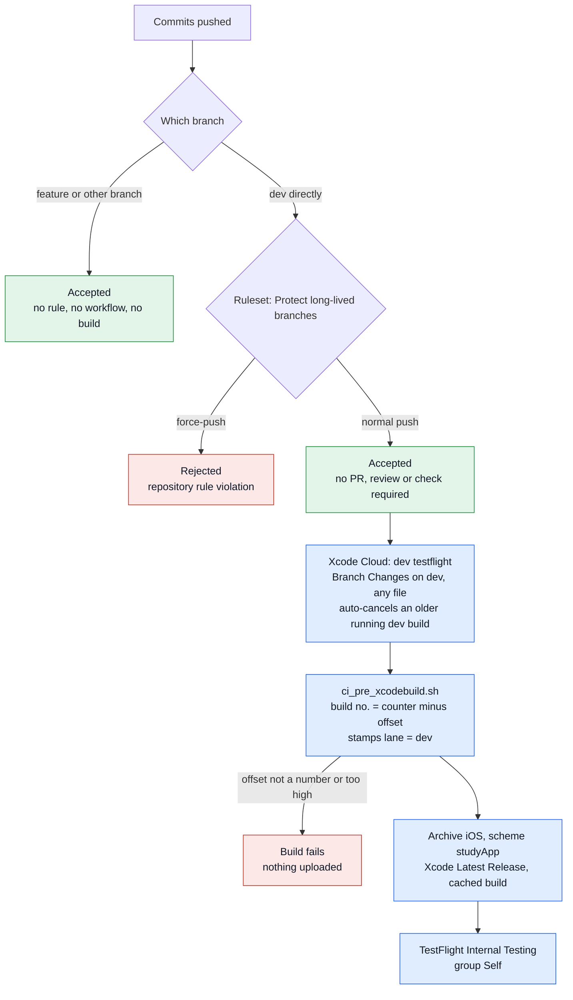
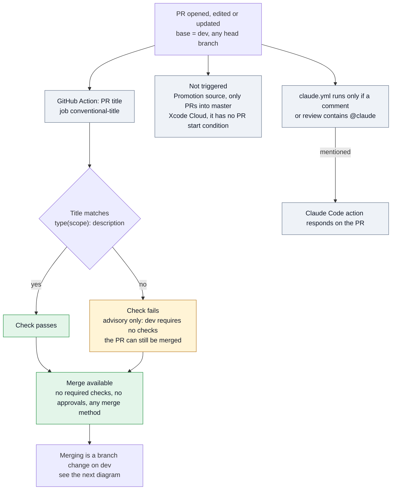
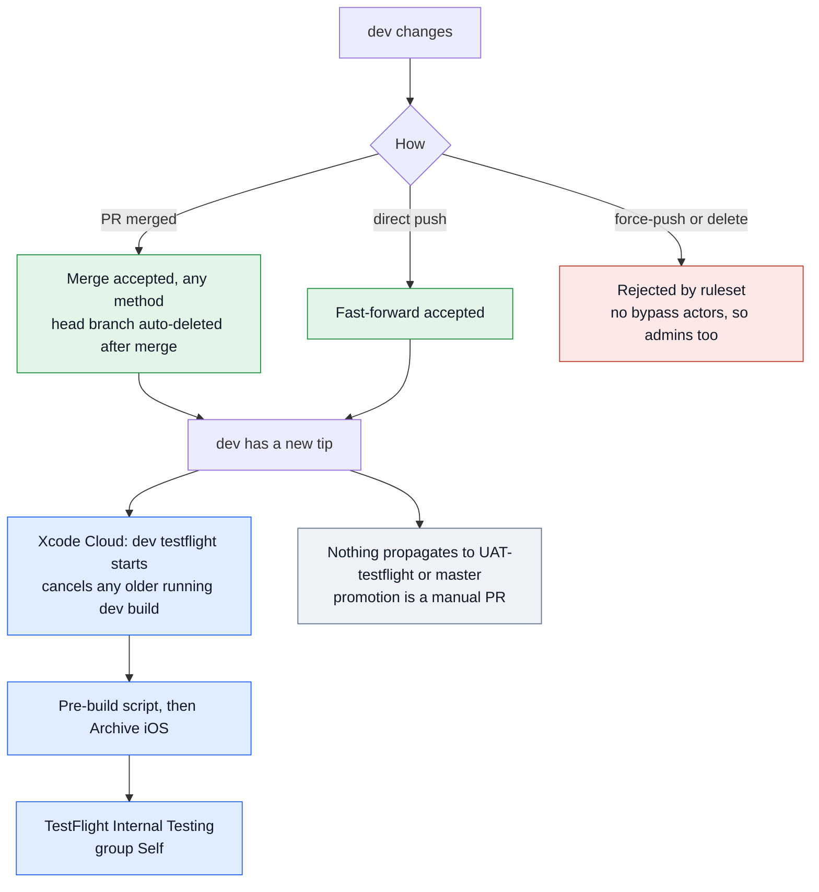
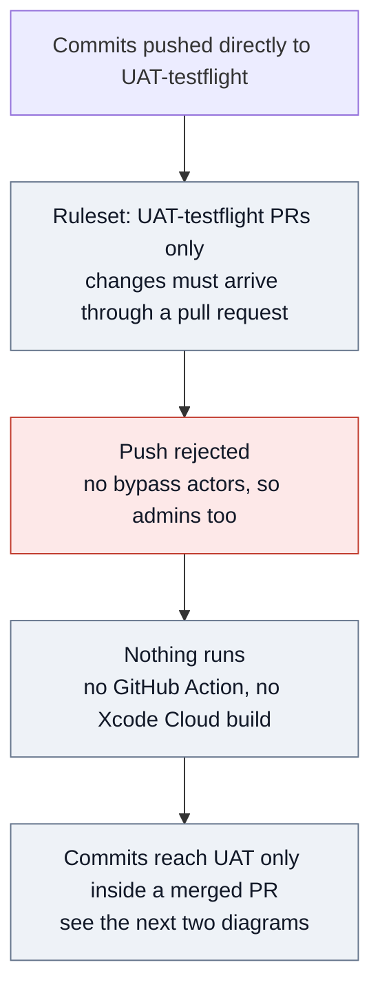
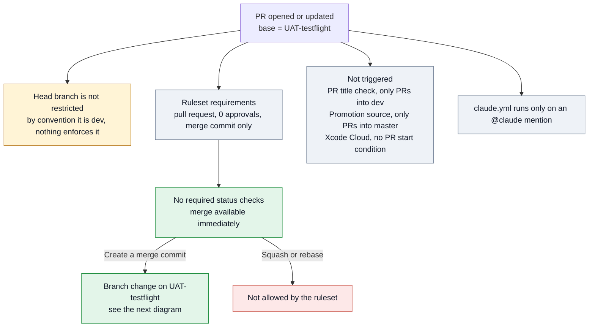
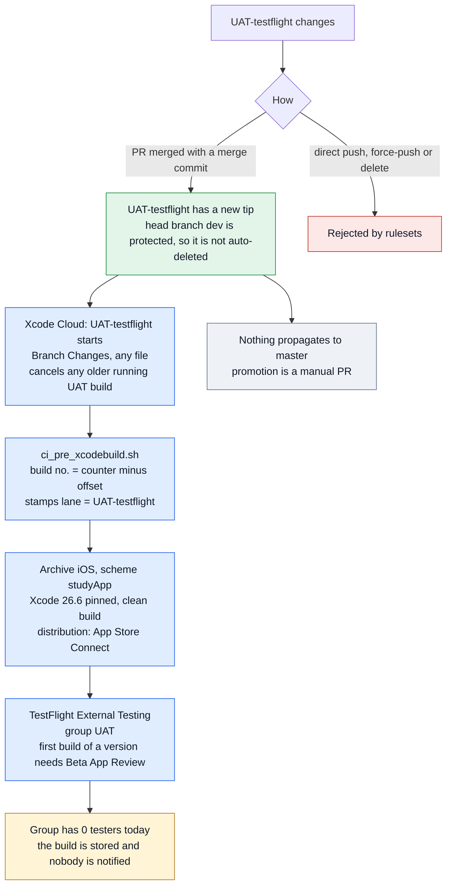
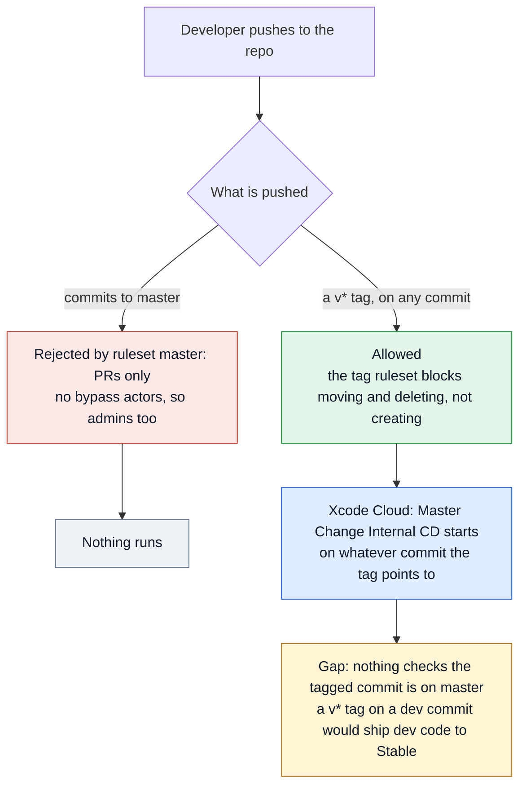
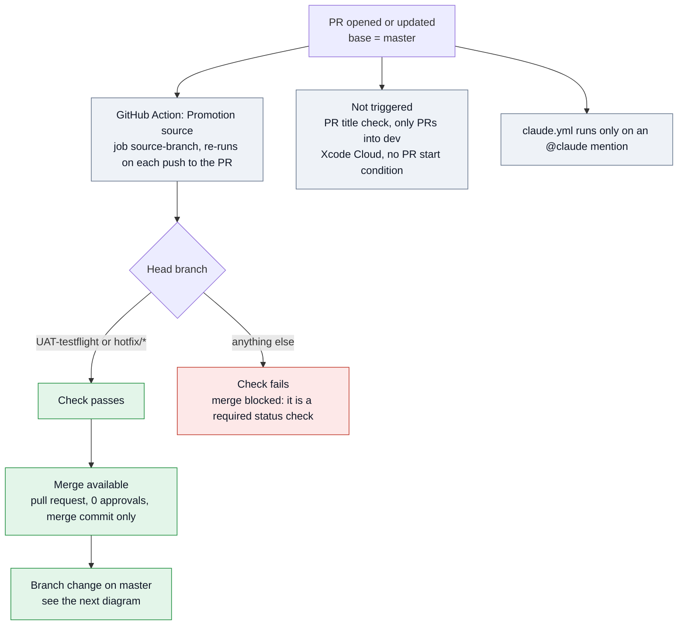
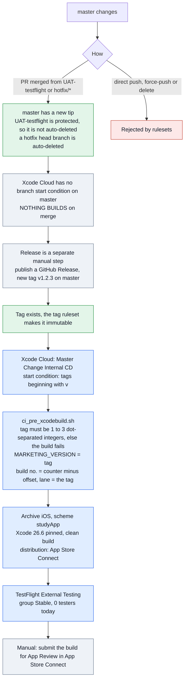

# Pipeline automation

What runs automatically for each kind of change, on each environment branch.
See [pipeline.md](../pipeline.md) for the procedures; this file only shows what
the automation does.

**Sources.** GitHub rulesets, workflows and triggers were read live on
2026-10-24. Xcode Cloud workflow settings were last read from App Store Connect
on 2026-10-09, so re-check them there if you have changed a workflow since.

**What the three headings mean**

| Heading | Meaning |
|---|---|
| Commits | commits pushed straight to the environment branch (or a tag, for `master`) |
| New PRs | a pull request opened or updated with that branch as its base |
| Branch changes | the branch moving: a PR merge, a direct push, a force-push or delete attempt, and what each one triggers |

**Colours.** grey = GitHub automation, blue = Xcode Cloud, green = allowed,
red = rejected or failed, yellow = a gap or advisory-only check.

Not shown yet: the SwiftLint workflow, merged into `dev` by PR #158 on
2026-10-26 (supersedes #152). It adds a `swiftlint` check to the "New PRs"
diagrams for `dev`, `UAT-testflight` and `master`, and runs on pushes to `dev`;
it reaches UAT and `master` with the next promotion. PR #153 (PR template) is
merged and PR #139 (cloud session tooling) is closed, unmerged.

---

## dev

### Commits

### New PRs

### Branch changes

---

## UAT-testflight

### Commits

### New PRs

### Branch changes

---

## master

### Commits

### New PRs

### Branch changes

---

## Gaps these diagrams show

1. **A `v*` tag on any commit builds and distributes to Stable.** Nothing checks
   the tagged commit is on `master`. Tag rules can stop a tag being moved but
   not stop it being created on the wrong commit; a guard in
   `ci_pre_xcodebuild.sh` is the practical fix.
2. **Nothing builds or tests a pull request.** Xcode Cloud has no PR start
   condition in any workflow (as of 2026-10-09), so the tests that now exist
   run only on a developer machine.
3. **UAT accepts a PR from any branch.** Only `master` checks the source.
4. **The UAT and Stable TestFlight groups have no testers**, so those builds
   are stored but nobody receives them.
5. **The PR title check is dev-only and advisory.** It does not run for
   promotion PRs, whose titles become the merge commit messages on UAT and
   `master`.

---

## Verified 2026-10-26

Checked with draft probe PRs (#159 into `dev`, #160 into `master`, both closed,
branch deleted) and read-only API calls. The SwiftLint workflow was exercised
from PR #158's branch, before #158 merged into `dev`.

| Check | Probe | Expected | Observed | Run |
|---|---|---|---|---|
| `conventional-title` | #158, valid title | pass | pass | [run](https://github.com/bradwils/studyApp/actions/runs/40201720897) |
| `swiftlint` | #158, no violations | pass | pass | [run](https://github.com/bradwils/studyApp/actions/runs/40201720773) |
| `swiftlint` | #159, `import SwiftUI` in a ViewModel and a lowercase type name | fail with two errors | fail, annotations `no_swiftui_in_viewmodels` and `type_name` | [run](https://github.com/bradwils/studyApp/actions/runs/40201886555) |
| `conventional-title` | #159, valid title | pass | pass | [run](https://github.com/bradwils/studyApp/actions/runs/40201886556) |
| `conventional-title` | #159, title edited to a non-conventional one | re-runs and fails | re-ran and failed | [run](https://github.com/bradwils/studyApp/actions/runs/40202002841) |
| `source-branch` | #160, head not `UAT-testflight` or `hotfix/*`, base `master` | fail, merge blocked | fail, `mergeStateStatus` BLOCKED | [run](https://github.com/bradwils/studyApp/actions/runs/40202042185) |
| `swiftlint` | #160, base `master` | runs (paths filter covers `master`) | ran and failed on the probe's errors | [run](https://github.com/bradwils/studyApp/actions/runs/40202042172) |
| PR title check | #160, base `master` | not triggered | no new run; the checks listed on #160 were #159's, matched by commit | n/a |

Other findings:

- The four rulesets match the `pipeline.md` table: no bypass actors, no
  force-push or deletion on the three branches, PR with 0 approvals and merge
  commit only on `UAT-testflight` and `master`, `source-branch` required on
  `master`, `v*` tags blocked from update and deletion. The `UAT-testflight`
  ruleset has no source restriction or required checks (gap 3 stands).
- Xcode Cloud does report to GitHub for branch builds: a check run
  (`studyApp | dev testflight | Archive - iOS`) and a commit status appear on
  `dev` and `UAT-testflight` tip commits. Not every commit has one (`ced5043`
  has none). No Xcode Cloud result was found on `master`, which only builds on
  tags, and it is not a required check on any branch.
- `claude.yml` only fires on `issue_comment`, review, review comment and issue
  events whose text contains `@claude`. Other comments still start a run that
  the job-level `if` marks skipped, so skipped `claude` check runs pile up on
  `master`.
