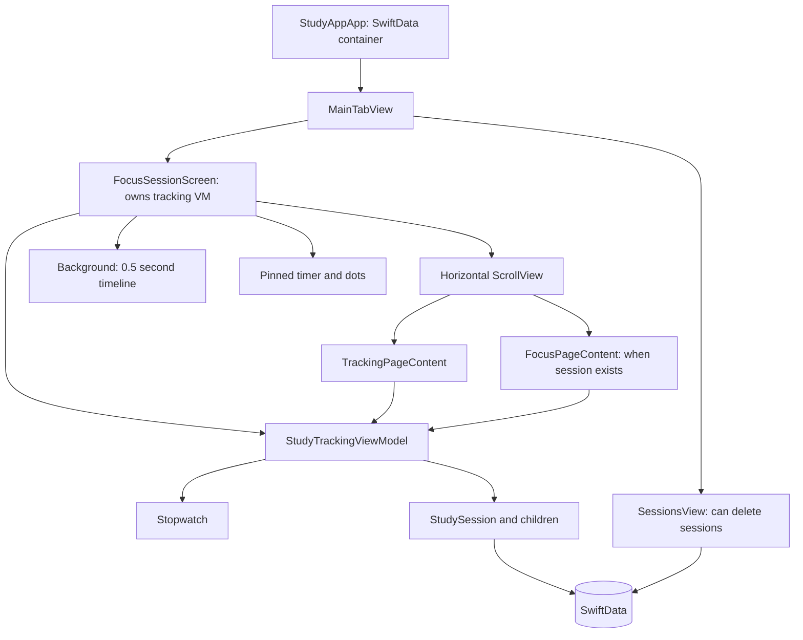
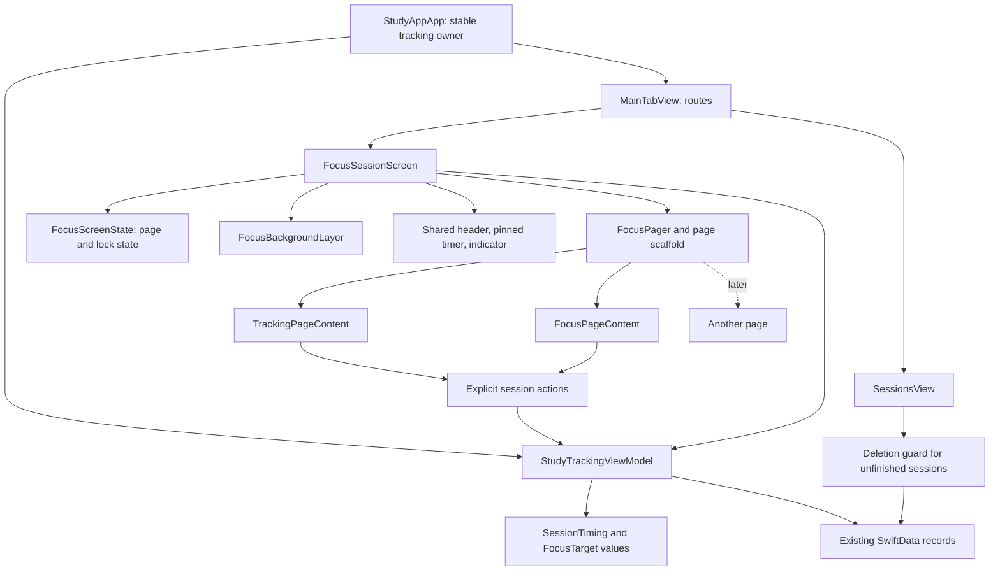

# Study, focus, and tracking architecture — draft implementation plan

**Status:** draft for review and later execution on a Mac. This branch changes documentation only.

**Planning branch:** `docs/study-focus-architecture-plan`, based on `dev` at `abcb18f3d94a3a01c5acc79ba9141e0b03bd4133`.

**Related work inspected:** the [previous focus proposal](https://github.com/bradwils/studyApp/blob/7ecb926/docs/FocusScreenArchitecture.md) at `7ecb926`, and `Study-items-V2` at `f8aad709d24b12d142bbea7d17ad30e315d444f2`. Neither branch is merged into this planning branch. Study-item types described below are candidate integration inputs, not types already available on `dev`.

**Validation performed:** source, tests, project settings, and branch comparison. This environment is Linux and has neither Xcode nor an iOS simulator. No app build, simulator run, performance measurement, or Swift compilation was performed. All proposed APIs are design sketches, not compiled implementations.

## 1. Direction and scope

Keep the horizontal pager, the timer that stays in place while swiping, and the backgrounds that transition independently of page content. These are sound foundations. Make adding a page or element a small, local change, while keeping session time and saved history reliable as the feature expands.

The recommended design has three responsibilities:

1. **Session coordination:** one owner handles study timing, pauses, focus targets, and writes to SwiftData. Pages request actions; they cannot edit the session's internals.
2. **Screen presentation:** one small state object handles page identity, selection, scroll progress, and focus lock. It has no persistence responsibilities.
3. **Composition:** a SwiftUI screen assembles the pager, common layout, pinned timer, shared elements, and page content. A page supplies its own content without recreating that infrastructure.

Use the existing MVVM, Observation, and SwiftData approach. Add a few concrete types where a responsibility has a name. Do not introduce a new application framework, dependency injection container, generic repository, or runtime plugin system.

### Scope boundaries

| In this plan | Separate work |
|---|---|
| Study/focus page structure, shared UI elements, state ownership | A full visual redesign |
| Session, pause, focus-target, and persistence correctness | Social backend, sync, Live Activities, notifications |
| Extension points for pages, controls, and study-item displays | Building all future pages or a configurable dashboard now |
| A compatible path for StudyItems V2 | Redesigning V2's field storage or merging its branch here |
| Targeted core tests and a Mac verification checklist | A broad UI-test rewrite or CI/release changes |
| A recovery boundary for unfinished sessions | A silent, automatic multi-session recovery engine |

### How to read and execute this plan

- Sections 2–4 explain the current structure, problems, and ownership decisions.
- Sections 5–8 define the pager, shared UI, time, persistence, and item contracts.
- Section 9 gives concrete recipes for expansion.
- Section 10 is the ordered implementation checklist with files and verification.
- Sections 11–12 contain local checks, decision defaults, and completion criteria.

Treat recommended product behavior as a draft default, not as something already agreed or implemented. The UI-only work can proceed independently of item-history schema decisions.

## 2. What exists today

Paths and line references in this section refer to the pinned `dev` commit above. Prefer source over the README and older overview: those still mention removed stores and types.



| Source | Responsibility today | Architectural consequence |
|---|---|---|
| [FocusSessionScreen.swift](../../studyApp/Views/Focus/FocusSessionScreen.swift), lines 9–99 | Owns the session VM, scroll geometry, background update schedule, and pager | Presentation and session lifetime are coupled to one view's identity |
| Same file, lines 103–204 | Backgrounds, pinned timer, digits, indicator | Good sibling layering; two-page assumptions and timer selection are embedded here |
| [FocusPagerLayout.swift](../../studyApp/Views/Focus/FocusPagerLayout.swift) | Header height, timer slot, page indices, ring constants | Layout geometry and navigation identity share a type; each page must honor the same spacing contract |
| [StudyTrackingView.swift](../../studyApp/Views/Focus/StudyTrackingView.swift) | Declares `TrackingPageContent`; subject picker, placeholders, session controls, secondary paged row | Filename and type disagree; page reads stopwatch internals |
| [FocusPageContent.swift](../../studyApp/Views/Focus/FocusPageContent.swift) | Duration draft, picker animation, unlock taps, lock toggle, focus-target start/reset | Local interaction state is mixed with shell policy and session mutations |
| [StudyTrackingViewModel.swift](../../studyApp/ViewModels/StudyTrackingViewModel.swift) | Session actions, stopwatch, break/section arrays, focus goal, picker limits, lock flag | Several independent sources of truth and unrelated responsibilities |
| [Stopwatch.swift](../../studyApp/Models/Stopwatch.swift) | Adjusted elapsed-time anchor and pause timestamps | A useful value-type starting point; independent `Date.now` reads and optional fields weaken its invariants |
| [StudySession.swift](../../studyApp/Models/StudySession.swift) | Session, break, section, and location records | Already supplies persistence; no new storage framework is needed |
| [ActiveSubjectList.swift](../../studyApp/Views/Components/ActiveSubjectList.swift) | Subject query, binding, fallback selection | Picker writes must also pass through the session owner's guard |
| [SessionsView.swift](../../studyApp/Views/Sessions/SessionsView.swift) / [SessionViewerViewModel.swift](../../studyApp/ViewModels/SessionViewerViewModel.swift) | Query, detail navigation, deletion | Another route can delete the record the timer still considers active |
| [AppSession.swift](../../studyApp/ViewModels/AppSession.swift) / [MainTabView.swift](../../studyApp/App/MainTabView.swift) | Typed top-level tab selection | A useful precedent for typed navigation; `AppSession` is not a study-session store |

`HorizontalContentScrollRow` is a separate `TabView` for media/leaderboard placeholders. It is not the main focus pager. `CustomBottomSheet` is currently commented out at its focus-page call site; its 531 lines are not a prerequisite for this refactor.

### Findings to address deliberately

These are source-level findings. A simulator is still needed to establish visual symptoms and runtime behavior.

| Priority | Evidence | Consequence / planned response |
|---|---|---|
| Core | VM `endSession`, lines 230–244, assigns completed fields but never saves the supplied context | Same-context fetch tests do not prove persistence. Save explicitly and test from a fresh context |
| Core | `pauseSession` records `lastPausedAt`; a `StudyBreak` is appended only in `resumeSession` | Ending while paused omits the final pause from saved breaks and inflates active time |
| Core | `studySections` is reset and copied at finish but never populated | `totalStudyingTime` remains zero and saved section history is empty |
| Core | VM has both arrays and a persistent session with its own arrays; end/cancel do not clear the VM arrays | Two representations can drift; current cleanup tests use empty arrays and miss it |
| Core | `startSession` / cancel swallow save errors; cancel force-unwraps an optional session | UI can report a successful transition without a durable write; repeated cancel can crash |
| Core | Focus progress uses wall time from focus start; resume shifts only the goal date | Focus progress advances while paused, then can jump backward on resume; the denominator also changes |
| Core | `startPureFocusSession` accepts zero/invalid durations and has no running-session guard | Target existence is incorrectly treated as evidence that focus is running |
| Core | History deletion accepts all `StudySession` records | An active record can disappear while the tracker retains it |
| State | `sessionIsRunning` means `activeSession != nil`, while `timerIsRunning` means stopwatch running | Paused and active are easy to confuse; dots disappear when paused although the focus page still exists |
| State | Tracking page's `currentStudySessionInProgress` is always `false`; picker binds directly to `selectedSubject` | The picker bypasses `updateSubjectSelection` and can disagree with the subject captured on the active record |
| State | Public writable `ssw`, arrays, target, lock, and subject | Future pages can bypass validation and create invalid combinations |
| Pager | Indices 0/1, `0..<2`, and a clamp to `1` are distributed across shell/layout | A third page requires editing unrelated rendering logic |
| UI | Page-local tab-bar toolbar; no explicit scroll selection binding | Off-screen content participates in shell policy; page removal relies on scroll clamping |
| UI | Shell comment says timer/background share a timeline, but digits are now outside it | Preserve the actual layer arrangement first; do not rely on stale comments as compositing evidence |
| UI | Timer renders focus goal through `ElapsedTimerText`, whose formula is tick date minus anchor | A future deadline uses elapsed-time semantics and can produce negative formatting; countdown needs its own mode |
| UI | Focus page's main-action helpers are unused; picker limits live in VM | Remove unused helpers when editing that file; move readonly presentation configuration out of the session owner |
| UI | Daily total, summary, and “since last break” include placeholders/stubs | Moving these is not implementing statistics; label them as separate work |

### What to retain or correct from the earlier proposal

Retain typed page IDs, one ordered page list, separation of continuous progress from page selection, exhaustive rendering switches, and the idea that shared elements belong to the shell.

Correct these details before implementation:

- An unclamped triangular weight does **not** sum to one during overscroll. At position `-0.2`, the first page receives `0.8` and the others receive zero. Clamp to the current page range before calculating weights, including a one-page list.
- Returning a valid `currentPage` from a computed property does not repair the optional scroll binding or a stale fractional position. Reconcile all three when pages disappear or reorder.
- `.scrollPosition(id:)` is not proof that scrolling has settled. Confirm settlement using scroll phase; keep requested, observed, and settled selection roles explicit.
- Fading every background to its page weight in a `ZStack` is not automatically a true color crossfade. Opacity compositing can expose the backing layer and darken a midpoint. Preserve existing visuals first and define the composition separately.
- Do not disable hit testing on an entire shared header just to make the timer transparent to swipes. The subject picker and future buttons must remain interactive.
- Do not move a screen model into `@Environment` simply because there are three pages. Explicit small inputs and actions are still readable at that size.
- Source extraction alone does not prove lower invalidation cost. Measure before making a performance claim.

## 3. Ownership and dependency direction



This is a component/dependency sketch, not a claim that each box needs its own module, service, or file. SwiftData's local store is persistence inside the iOS app, not a separately deployed service.

### Ownership table

| State or operation | Owner | Why |
|---|---|---|
| Active session reference, validated start/pause/resume/finish/cancel | `StudyTrackingViewModel` | Same rules regardless of which page issues an action |
| Runtime timing and focus-target values | Private values owned by tracking VM | One timing authority; no UI dependency |
| Saved break/section records | Active `StudySession` relationships | One durable history, updated at transitions rather than reconstructed at the end |
| Draft subject for the next session | Tracking VM, changed through a method | Shared across relevant pages; cannot overwrite the active subject |
| Active subject shown during a session | Active record, with stored name fallback | Reflects the session being timed even if its subject is deleted |
| Available pages | Pure policy from a session snapshot | One ordered list for pager, dots, fallback, and progress bounds |
| Bound page ID, settled page ID, fractional position | `FocusScreenState` | Navigation is not session timing |
| Focus lock enabled | `FocusScreenState` | Controls pager/tab-bar interaction, not accounting |
| Unlock-tap count, last tap, shake trigger | `FocusLockControl` local state | Local interaction; resets on a fresh lock/session identity |
| Draft focus duration, picker measurement | Focus page or its controls | No other page needs a half-edited picker value yet |
| Layout, fonts, animation, haptics, accessibility settings | Views | Keep SwiftUI out of ViewModels and models |
| Database reads | Feature `@Query`; focused fetches for commands/recovery | Preserve the repository's SwiftData pattern |
| ModelContext | SwiftUI environment, passed into commands | Do not store a context on the VM |
| Save error and pending command | Tracking VM; shell renders an error/retry affordance | A failed write is part of the action outcome |

### Lifetime and access

- Create one tracking VM in the app composition root and inject it through `MainTabView` into Focus. Keep `AppSession` focused on app navigation. Do not create another tracker for a new page or tab.
- The focus screen owns its presentation state using `@State`. Leaving and returning to a tab must not restart study timing. Rebuilding the screen may reset page selection to tracking; it must reconnect to the same tracker.
- Use `private(set)` for externally readable session state and private storage for timing internals. Views receive domain snapshots and validated actions; they never mutate `ssw`, breaks, sections, or target timestamps.
- Keep the existing class name initially to reduce churn. Normalize command labels to `context:` when those call sites are migrated. A later rename is not an architecture prerequisite.
- The current target defaults app code to MainActor isolation. Make isolation explicit for the coordinator/tests where useful, and verify with Xcode; do not redesign concurrency for this feature.
- The app currently has one `WindowGroup`. Multiple independent windows/processes claiming the same unfinished session are a future ownership decision, not something this in-memory owner guarantees.

## 4. The smallest useful set of types

Add types as their implementation step needs them. Names are proposals; keep responsibilities stable if names change.

| Type | Kind and location | Contract |
|---|---|---|
| `FocusPage` | Plain enum, `ViewModels/Focus/FocusPage.swift` | Stable identity, no numeric raw values; exhaustive case handling |
| `FocusPagePolicy` | Small value / pure functions in the same feature folder | Produces ordered available IDs and page presentation descriptors from session facts |
| `FocusScreenState` | `@Observable final class`, `ViewModels/Focus/` | Bound/settled page, progress, lock, reconcile/navigation methods; no tracking VM ownership or SwiftData |
| `SessionTiming` | Plain Swift value, `ViewModels/Focus/` | Running/paused timing with explicit timestamps; successor to stopwatch internals |
| `FocusTarget` | Plain Swift value in the timing feature | Positive target duration and active-time baseline; no SwiftUI or timer publisher |
| `SessionSnapshot` | Small derived value, if needed by multiple consumers | Phase, identity, subject display facts, elapsed/break/target facts at one supplied time; not another mutable store |
| `TimerDisplay` | Plain enum near timing presentation mapping | Idle, elapsed anchor, break anchor, countdown deadline, or frozen seconds |
| `FocusPageScaffold` | Generic SwiftUI container, `Views/Focus/` | Applies shared reserved space and content layout once |
| Background, pinned timer, indicator, lock controls | Concrete `View` structs under `Views/Focus/` | Small input sets, independent local state where appropriate |

Do not add an observable view model to each extracted button, row, or section. A value input plus an action closure is usually sufficient. Do not store both a snapshot and all its mutable source fields.

An initial folder shape, with optional files added only when used:

```text
studyApp/
  ViewModels/
    StudyTrackingViewModel.swift       # retained session coordinator
    Focus/
      FocusPage.swift
      FocusPagePolicy.swift
      FocusScreenState.swift
      SessionTiming.swift
      FocusTarget.swift
      TimerDisplay.swift
  Views/Focus/
    FocusSessionScreen.swift           # composition and environment bridge
    FocusPager.swift
    FocusPageScaffold.swift
    FocusPagerLayout.swift             # temporary shared geometry, no page IDs
    Pages/
      TrackingPageContent.swift        # rename from StudyTrackingView.swift
      FocusPageContent.swift
    Components/
      FocusBackgroundLayer.swift
      PinnedTimerView.swift
      FocusPageIndicator.swift
      SessionControls.swift
      FocusTargetControls.swift
      FocusLockControl.swift
```

Keep app-wide components in `Views/Components` only when actually shared outside Focus. Do not move every existing component as part of this task. Xcode uses filesystem-synchronized groups; check target membership after moves rather than preemptively hand-editing `project.pbxproj`.

## 5. Pager and shared-element contracts

### 5.1 Identity and availability

Use stable page identity and a separately ordered list:

```swift
enum FocusPage: Hashable, Identifiable {
    case tracking
    case focus

    var id: Self { self }
}
```

Do not use `allCases` to decide availability. A known page may be unavailable in a given session. The initial policy is:

| Session phase | Pages | Indicator | Subject editing |
|---|---|---|---|
| Idle | `[.tracking]` | Hidden | Allowed through the selection command |
| Running | `[.tracking, .focus]` | Two dots | Disabled |
| Paused | `[.tracking, .focus]` | Two dots | Disabled |

This preserves access to the focus page while paused and deliberately fixes its missing dots. A page list is nonempty, has unique IDs, and always includes tracking as fallback. Tests should accept arbitrary fixture lists so a three-page case can be checked without shipping a dummy page.

Render `ForEach(availablePages)` with `.id(page)`, `.containerRelativeFrame(.horizontal)`, a zero-spacing `HStack`, and `.scrollTargetLayout()`. Keep `.scrollTargetBehavior(.paging)`. Introduce `.scrollPosition(id:)` for typed programmatic navigation; do not replace the main pager with a `TabView` merely to obtain selection.

### 5.2 Requested, observed, and settled position

The screen state distinguishes:

- **Scroll binding:** optional page ID used by `.scrollPosition(id:)`; assigning it requests a destination and SwiftUI may update it while moving.
- **Settled page:** last valid page committed when scrolling becomes idle. Use for discrete policies and accessibility focus.
- **Fractional position:** continuous visual coordinate from geometry. Use only for gradients, dots, and visual transitions.

Provide `navigate(to:)` and `reconcile(availablePages:)` methods. When a session ends/cancels, the page set changes, or order changes:

1. Validate the bound and settled IDs against the new list. Prefer a still-valid identity; otherwise choose tracking.
2. Set the scroll binding to that identity and reset fractional position to its new index, even if the old number happened to be in bounds.
3. Clear the lock on session identity change/removal.
4. Suppress an unnecessary navigation animation when removing the visible page. Ensure the actual scroll view reaches fallback; a computed fallback alone is insufficient.
5. Ignore geometry callbacks from an obsolete page-list revision, or reapply reconciliation after layout/idle. Test removal while a drag or deceleration is active.

Use scroll-phase observation to commit settlement. Do not round continuous progress for business actions or assume scroll-binding updates imply settlement. Rotation/viewport-width changes recalculate position from current geometry and reconcile by identity. Verify right-to-left layout before claiming support; normalize physical offsets once in the pager adapter rather than throughout the views.

### 5.3 Continuous weights

For `n >= 1` pages, a finite raw position `r` from horizontal travel divided by viewport width becomes:

```text
p = clamp(r, 0, n - 1)
weight(page at index i) = max(0, 1 - abs(p - i))
```

For missing/nonfinite geometry, use the valid selected page's index. A zero viewport width must not divide. Indices exist only inside this geometry/interpolation helper; they are not page identity.

Examples for a three-page fixture:

| Raw position | Weights |
|---|---|
| `-0.3` | `[1, 0, 0]` |
| `0` | `[1, 0, 0]` |
| `0.25` | `[0.75, 0.25, 0]` |
| `1.5` | `[0, 0.5, 0.5]` |
| `2.4` | `[0, 0, 1]` |

Weights sum to one throughout the valid range and after overscroll clamping. For a single page its weight is always one. Page-indicator count, backgrounds, and progress bounds all consume the same list.

Under Reduce Motion, choose one nearest valid page for visual weights and avoid travel-driven crossfades/scaling. Keep normal swipe navigation. This rendering rule does not change session time or mark a page settled early.

### 5.4 Shared elements without a universal component registry

Give page presentation a small typed descriptor, resolved in one exhaustive switch. Start with named options such as header style (`tracking` / compact subject), summary visibility, and background style. Keep SwiftUI `Color`, `Font`, and concrete views in the view layer; descriptors carry semantic values.

The existing pages both use the shared timer layout; that is the initial default, not a permanent requirement for every future page. When a full-content or timer-free page is actually added, extend the descriptor with a typed layout/visibility choice and teach the shell/scaffold how to reserve space for it. Keep the timer visually stationary while it is shown, and define its transition when entering a page that hides it. Do not make the page supply fake spacers or edit timer internals to opt out.

The shell renders stable infrastructure and global policy. Pages render their own sections:

| Element | Owner | Extension mechanism |
|---|---|---|
| Background | Shell background layer | Add a semantic style and its rendering switch |
| Subject / total header | Page initially; optional shell header later | Explicit header variant; don't erase the current visual distinction accidentally |
| Pinned timer | Shell | One `TimerDisplay` input; pages never create a second session timer |
| Page indicator | Shell | Derived from available list and weights |
| Tab-bar visibility / pager interaction | Shell | Focus-lock policy, applied once |
| Session buttons | Tracking page / reusable `SessionControls` | Values plus start/pause/resume/finish actions |
| Focus duration/reset | Focus page / `FocusTargetControls` | Draft binding, validation result, start/reset actions |
| A future item picker, notes panel, or media row | The page that uses it | A normal section or concrete child view |
| A future element required on several pages | Named shell slot | Add a typed option and one renderer when that requirement exists |

Avoid a `Set` of arbitrary hidden element identifiers at first. A handful of named fields is easier to read and makes variants explicit. If visibility grows substantially, a `SharedElement` enum and per-page set are a reasonable later replacement. That table still controls presentation only; it never changes session accounting or deletes item data.

For a crossfaded interactive element, opacity is only visual. Disable hit testing and hide accessibility for inactive copies; do not leave an invisible picker or button operable. Prefer one interactive header with a defined settled-page policy to two overlapping live pickers.

### 5.5 Layout in two stages

**First, preserve geometry.** Keep the existing 96-point header and scaled timer slot while extracting a single scaffold that reserves those bands. The shell applies it around page content. Remove repeated padding/slot knowledge from page implementations. The timer's font and reserved height should come from one layout specification passed to the timer and scaffold; don't silently replace the current 90/120 relationship during extraction.

**Then, if needed, centralize the header and measure its intrinsic height.** The full-viewport pager remains behind the pinned visual layer, and the shell's page wrapper reserves the measured header/timer bands. This preserves swipes beginning over the timer. A short-content pager placed entirely below the header would shrink that gesture region.

- Measure only the bounded header/timer content, never a full-height stack with `Spacer`.
- Keep the measured view independent of the inset it produces to avoid a geometry feedback loop.
- Disable hit testing only on decorative backgrounds, timer digits, and noninteractive dots. Header controls stay hittable.
- Use stable layout during a swipe; avoid changing reserved height at the halfway point. Reserve enough space for the participating header variants or use an explicit transition layout.
- Verify safe areas and tab-bar hide/show before deleting `PinnedTimerSlot`. Do not assume `.safeAreaPadding` alone accounts for all nested insets.
- Large Dynamic Type and short/landscape windows may need vertically scrollable page bodies or a compact arrangement. `AnyLayout` is an option for a real size-class variant; it is not needed for the first extraction.

### 5.6 Background composition and update scope

Initially preserve the existing gradient composition. Separate generalized page weights from how backgrounds are actually composited. When changing that composition, use an explicit adjacent-page transition: render the source background fully, then overlay the destination at transition fraction, with a defined backing color. Validate semi-transparent tracking gradients against that backing. Do not fade both layers to complementary alpha and assume they interpolate colors correctly.

Keep background animation identity stable across body updates and page changes; random idle parameters must not be regenerated on every scroll/timer update. Stop or reduce unnecessary idle motion under Reduce Motion and while the scene is inactive.

Put time-driven updates close to their consumers:

- Timer text receives its schedule date and derives display from that date.
- Focus gradient gets a target-progress projection at the same notion of time, with an appropriate local schedule.
- The pager and forms should not rebuild just because a timer digit ticks.
- Scroll progress should invalidate only consumers that read it. Extracted structs help establish boundaries but do not guarantee a performance improvement.

Preserve timer/background compositing order while extracting. Check `.blendMode(.difference)` over both gradients, dark/light appearance, and intermediate swipe positions. Do not introduce a compositing group without testing what it does to contrast.

## 6. Session and time contracts

### 6.1 One transition owner

The tracking VM is the only writer for active-session transitions. Its initial public facts should include `hasActiveSession`, a running/paused/idle phase, `canSelectSubject`, `hasFocusTarget`, and a derived timer display. Remove the misleading `sessionIsRunning` name once its call sites use the correct fact.

Replace the stopwatch's independently optional flags/timestamps with a small runtime value whose cases hold their required fields. For example, running holds segment start plus accumulated active seconds; paused holds pause start plus accumulated active seconds. A missing timing value means no active session. Do not also store a second independently editable phase enum.

The active SwiftData record is history and identity; timing is the private runtime projection. They are changed together by commands. Expose neither for arbitrary view mutation. Assert/test the invariant that an active record and its timing value exist together after each successful transition.

### 6.2 State transitions and history

| Action | Valid from | Timing/history change | Result |
|---|---|---|---|
| Start | Idle | Capture subject snapshot; create session and first open study section at the same `now` | Running |
| Pause | Running | Close the open section at `now`; create an open break; set `lastPausedAt` | Paused |
| Resume | Paused | Close the open break at `now`; open a study section; clear `lastPausedAt` | Running |
| Finish | Running | Close the open section; set `endedAt`; finalize totals and save | Idle after successful save |
| Finish | Paused | Close the open break; clear `lastPausedAt`; set `endedAt`; finalize totals and save | Idle after successful save |
| Cancel | Running or paused | Delete the active session and owned children, then save | Idle after successful save |
| Reset focus target | Running or paused | Clear only target state | Session remains in its current phase |
| Start focus target | Running with valid positive duration | Capture current active-time baseline | Same session, target available |

Repeated pause/resume/finish/cancel must be harmless or return a clear unavailable-action result. None may force-unwrap a missing session or append another interval on retry. Starting an already-active session does not silently replace it.

Keep breaks and sections on the active record throughout its life; remove the VM's parallel mutable arrays. An open break has `endedAt == nil`. Its current convenience initializer sets an end date, so the transition implementation must deliberately create/mark an open break rather than assume that initializer is open-ended. Optional relationship arrays can be initialized to `[]` at session creation without changing the persisted schema in this first pass.

Required invariants:

- Running: one open section, no open break.
- Paused: one open break, no open section.
- Finished: no open intervals; timestamps are nondecreasing; intervals do not overlap.
- Net study time is the sum of study sections; wall duration is net study plus breaks, within rounding tolerance.
- Any retained `totalBreakDuration` is a derived saved summary of break records, not another mutable timing authority.
- Finishing while paused accounts for the final break once.
- Cancelling removes owned children but preserves subjects and unrelated history.

The current code logs every nonnegative pause, despite an unused three-minute threshold and a separate five-minute design note. Recommended accounting default: **exclude every paused interval from active study time**. Short-pause classification can later label intervals without silently changing the accounting rule. Do not invent a threshold during a structural refactor.

### 6.3 Deterministic time

Read the clock once per command, then pass `now` into timing transitions and record updates. Provide a lightweight injected `now: () -> Date` dependency on the tracking VM for tests; runtime timing helpers accept `at:` explicitly. `TimelineView` rendering uses `context.date`, not an unrelated `Date.now` read in each component.

This allows a test to simulate ten minutes of study, two minutes paused, and five minutes more instantly. Remove sleep-based timing assertions as those tests are migrated. Do not accumulate seconds by incrementing a counter on timer ticks: render schedules can pause or skip ticks when the app is backgrounded.

For this iteration, persisted `Date` anchors support wall-clock recovery. Handle negative deltas from clock corrections defensively and keep history coherent; document that this is not a monotonic clock guarantee. If strict behavior across manual time changes becomes a requirement, introduce a monotonic source for live elapsed time with a separate persisted-wall-time reconciliation policy. Do not claim a `Date`-only implementation solves that problem.

### 6.4 Focus targets use active time

A focus target should store a target duration and the session's accumulated active seconds when it began:

```text
targetElapsed = max(0, sessionActiveElapsed(at: now) - activeElapsedAtTargetStart)
remaining = max(0, targetDuration - targetElapsed)
progress = clamp(targetElapsed / targetDuration, 0, 1)
```

The session's active elapsed value is frozen while paused, so both target progress and remaining time freeze naturally. There is no moving deadline to “pay back” on resume and no ratio that changes denominator after a break.

Validate duration in the command, not just the button: finite, positive, and within supported picker limits. The picker starts with no valid target selected; either keep start disabled at zero or choose an explicitly documented positive default. Do not start a zero-length target silently.

Recommended draft behavior: reaching the target leaves the study session running, displays zero remaining / complete progress, and retains the target until reset. It does not automatically finish, create a break, mark an item complete, or schedule a notification. Starting a replacement target requires an explicit reset/replace action. Target state is transient in this phase; persistence/recovery of it is separate work.

### 6.5 Display semantics

The view layer maps session facts into `TimerDisplay`:

| Situation | Recommended display |
|---|---|
| No active session | `--:--` |
| Running without target | Active study elapsed, count up |
| Running with target | Target remaining, count down and clamp to zero |
| Paused, with or without target | Current break elapsed; target progress remains frozen |
| Pending finish/save retry | Frozen display at the command's captured timestamp |

These defaults fix pause ambiguity; they are a small behavior change, not merely file cleanup. Keep them in a separate correctness commit from visual extraction.

An elapsed anchor and a deadline have different formulas. Either extend the timer view with explicit modes or add a countdown renderer beside `ElapsedTimerText`. Share formatting, but do not overload the meaning of `anchor`. Accessibility should announce the timer's purpose and value, with live updates throttled rather than speaking every second. Respect Reduce Motion for numeric transitions too.

### 6.6 Subject selection and history deletion

- Bind the picker through a getter/setter that calls the guarded selection method. Also disable the picker while active. Disabling alone does not protect programmatic/fallback writes.
- Automatic first-subject selection must use the same guard. Decide whether “no subject” is a valid deliberate choice before replacing it with an automatic fallback.
- Show active-session subject/name from the record while timing. The next-session draft is not the active identity.
- Prevent ordinary history deletion of unfinished sessions at both UI and command boundaries. “Remove Sessions” must skip or reject unfinished records rather than batch-delete the active record. Active cancellation goes through the tracking owner.
- If a subject is deleted, preserve the session and stored name; do not switch the active session to the next subject automatically.

## 7. Persistence, errors, and recovery

### Save boundaries

Explicitly save meaningful transitions: start, pause, resume, finish, and cancel. These are infrequent user actions, not timer ticks. Continue to pass `ModelContext` at the call site.

Use a throwing save or explicit result so UI can distinguish success from failure. This intentionally strengthens the repository's current `try? save()` convention for critical tracking actions: hiding a failure can lose study history or claim a cancellation that was never saved. No broad repository abstraction is needed.

### Failure handling must be designed before clearing state

A save error is not a successful finish. Use one small pending-change representation, scoped to this coordinator:

1. Capture one command timestamp and the intended interval changes. Stage each change once.
2. Attempt save. On success, publish the new runtime phase; finish/cancel can then release active state and clear the target.
3. On failure, retain the staged command and a safe display snapshot. Show a useful retry affordance and block conflicting session actions.
4. Retry saving that staged change. Do not recapture time, append another interval, recreate the session, or delete again.
5. For a pending finish, freeze display at the requested finish time. For a pending cancel, retain stable identity/display values separately; do not render a model already marked for deletion.
6. Clear pending/error state only after success or an explicitly implemented abandonment path. Do not call a shared context's global rollback to discard unrelated form changes.

Keep this concrete to the few session commands; it is not an event bus or generic transaction framework. If a command-scoped context is later chosen for isolation, pass IDs and re-fetch in that context; never pass model instances across contexts. Such a change must also verify observation in the main UI context.

Test a save failure through a narrow injected save closure or similarly small seam. Include failed start retry (no duplicate session), failed finish retry (same end time, no duplicate break), and failed cancel retry (no stale rendering). A fresh-context read before successful retry should still reflect the last saved state.

### Readback and recovery

After saving in persistence tests, fetch through a fresh `ModelContext` attached to the same container. Same-context reads can merely inspect unsaved cached objects. For a meaningful relaunch check, also use an isolated temporary on-disk store and reopen its container.

The current app inserts unfinished sessions but cannot reattach its in-memory stopwatch after process termination. Initial UI extraction must not silently pretend this is solved. After transition history is durable:

- Query unfinished sessions once at feature startup.
- Offer an explicit recovery choice for a single unfinished record. Reconstruct timing from saved intervals and `lastPausedAt`, rather than inventing a second session.
- If several unfinished records exist, show a resolution path; never choose one silently or merge their times.
- Define treatment of time while the app was closed. Recommended draft: offer to resume or finish at the last recorded activity point, with a clear explanation, rather than automatically crediting all closed-app time.
- Navigation state and lock reset on recovery; transient focus target is not restored unless separately persisted.

Recovery is a separate phase because its user decision and process-death tests exceed a behavior-preserving view refactor. Running timers must still survive ordinary tab changes and scene background/foreground transitions using timestamp calculation.

### Schema discipline

The initial pager/UI work needs no model-property changes. Updating existing sections/breaks at transitions also need not change their stored shape. Do not normalize optional relationship arrays, rename persisted fields, or change uniqueness attributes just to make the code prettier.

No `VersionedSchema` / `SchemaMigrationPlan` implementation was found on the inspected `dev` source. Before any actual schema change, compare current UAT and any migration work in progress; follow `AGENTS.md`'s UAT baseline guidance. For disposable dev data, document any reseed/reinstall requirement. Do not delete real history as a refactor step.

## 8. StudyItems V2 integration boundary

At `f8aad70`, V2 adds `StudyItem`, `FieldDefinition`, `FieldValue`, `Tag`, and a subject-to-items relationship. Items have native status/priority/due-date fields plus custom values. `FieldValue` uses optional storage slots selected by `FieldDefinition.kind`. Preserve that candidate design while planning its UI integration.

### Keep these concepts distinct

- A **study item** describes work to do.
- A **study session** records a period of activity.
- A **focus target** describes a temporary goal during that session.
- A **page** is one way to present those concepts.

An item's `inProgress` status must not become the timer's running flag. Starting a target does not automatically complete an item. A custom duration field is not a stopwatch.

### Integration sequence

1. Rebase/reconcile with the actual V2 work only when it is ready; do not cherry-pick an old model design from the earlier architecture branch. V2 has its own verification document and tests.
2. Add read-only item summary/list content as an ordinary page section. Keep the query scoped to relevant subjects/statuses, with empty and deleted-item states.
3. Introduce a selected item ID only when a flow actually uses it. For a pre-session picker, it can be draft selection; do not claim a historical association from a UI-only ID.
4. Put item mutation in a production item-editing VM or small operations type. Do not call `StudyItemDebugVM` from user-facing Focus pages.
5. Before tracking time per item, decide cardinality: one item per session or switching items within a session. **Recommendation:** if switching is required, associate work with sections so switching does not rewrite earlier time. If one item per session is sufficient, use a simpler optional session association. Do not add both speculatively.
6. Only then define the persisted relationship, inverse, delete rule, display snapshot, and migration. Deleting an item should preserve study history; a session must not cascade-delete its work item. Test both deletion directions.

The core session commands can later accept a validated work-selection draft without knowing which page gathered it. New UI can read a small work summary without receiving the whole field-editing graph.

### Field and status extension rules

| Extension | Local change | Keep independent |
|---|---|---|
| Show a built-in item field | Production item presentation configuration | Session phase, timer source, historical data |
| Add a custom field editor | Exhaustive view switch over `FieldKind`; validated item update | Pager/navigation policy |
| Add a new field kind | Model compatibility review, storage/editor/validation/tests | Session timing unless it is an explicit new requirement |
| Hide a field | Change rendering and accessibility | Do not clear the stored value |
| Edit custom value | Update the active slot and parent `updatedAt` consistently | Don't revive inactive V2 slots automatically |
| Change item status | Define `completedAt` semantics in item operations | Don't infer session start/finish from it |

V2's `BuiltInFieldGate` is explicitly a developer tool. Reuse the idea of typed display configuration where useful, not the dev-only view itself. V2 still has an explicit human decision about `completedAt`; do not silently resolve it in the focus refactor. Duplicate dropdown identities and parent timestamp updates are item-editor concerns, not reasons to redesign tracking.

## 9. Practical expansion recipes

### Add a third page

Example: a read-only session-notes page, when that feature is requested.

1. Add `.notes` to `FocusPage`.
2. Add its availability/order and semantic presentation in `FocusPagePolicy`.
3. Add one exhaustive `pageContent(for:)` case that creates `SessionNotesPage`.
4. Implement its content using the scaffold-provided layout and a notes-specific input/action API.
5. If it needs a different shared layout, add a typed presentation choice to the descriptor and implement that choice once in the scaffold/shell.
6. Add policy/reconciliation coverage and a preview. Verify a three-page swipe, dots, overscroll, and page removal.

No edits should be needed in elapsed-time calculation, break accounting, timer scheduling, or fixed page counts. If the notes are just an extra section on an existing page, skip steps 1–3 and add that section instead.

### Add an element to one page

Example: a study-item summary below tracking controls.

Create a concrete `StudyItemSummary` view with display values and an `onSelect` action. Insert it in `TrackingPageContent`. Add local state only if the component owns an interaction. Do not add a new global enum case or observable coordinator for a single ordinary row.

### Add a shared element

Example: an active-item banner needed on tracking and focus pages.

1. Define the small display input and selection action.
2. Add a named slot in the shared composition and a typed visibility/variant option in page presentation.
3. Render it once in the shell, or in the shared scaffold when it should travel with pages.
4. Decide reserved space, hit testing, accessibility, and swipe behavior when hidden or transitioning.
5. Preview all participating page states and verify large text/landscape.

This extends composition without moving item mutation into the shell or changing session timing.

### Add a new control or timing mode

A normal new button is a view plus a validated command. Reuse existing commands where semantics match. A genuinely new timing mode belongs in session rules first: define its transitions, history accounting, and display projection, test them, then add controls. Do not implement a second stopwatch inside the new page.

### Add user-configurable modules later

If users eventually choose/reorder cards within a page, add a separate typed section list at that point. Preserve section identity when reordering and persist configuration independently of study history. Page availability, field visibility, and section arrangement are different policies; don't combine them into one generic “element” store today.

### Choosing properties, functions, containers, and structs

| Mechanism | Use here | Avoid |
|---|---|---|
| Plain computed property | A cheap derived fact, or short private layout fragment | Cached copies of phase/availability; time reads hidden in many getters |
| Private function | An action, a transformation with arguments, or thin `@ViewBuilder` enum dispatch | A function returning every fragment merely to shorten `body` |
| Concrete `View` struct | Owned local state, independent animation/tick scope, reuse, meaningful preview | Extracting every `HStack` into a public API |
| Generic container | Shared scaffold with real header/content slots | `AnyView` arrays, string-keyed renderers, universal component factories |
| `ViewModifier` | Repeated styling of an existing view | Hiding session actions or an entire multi-view feature in a modifier |
| Small value type | Page policy, timing, duration constraints, display facts | Unused protocols for hypothetical future implementations |
| Observable reference type | Session owner or cohesive screen presentation state | One class for every visual element |

Suggested declaration order for edited views: nested types/constants; inputs/bindings; environment; owned state/namespace/scaled metrics; cheap derived facts; initializer if needed; `body`; private sections in visual order; actions; previews. Keep local state `private`. This is a readability convention, not a new lint project.

Use comments to explain unusual constraints, such as pinned timer gesture routing. Put the conceptual explanation in docs; avoid restating the layout in long inline comments. Preserve repository layering rules and do not import SwiftUI into ViewModels.

## 10. Ordered implementation checklist

Execute one step at a time on implementation branches from current `dev`. Re-read this plan against the latest source before starting; the pinned commits are analysis evidence, not instructions to reset newer work. Make separate correctness and presentation commits so review can identify intentional behavior changes.

### Step 0 — Capture a trustworthy baseline

- [ ] Inspect current `AGENTS.md`, branch state, UAT/schema changes, and the status of the V2 branch.
- [ ] On a Mac, build and run the unit target before edits; record existing failures rather than attributing them to the refactor.
- [ ] Capture idle/running/paused/focus/locked screenshots and a short swipe recording. Include the timer position, tab-bar hide/show, and gradient contrast.
- [ ] Record default product policies from section 12 in the implementation PR.

**Verify:** baseline evidence exists and no source has changed yet. Existing `StudySessionTests` and `AppSessionTests` replace the old removed-store tests; don't repeat the outdated master-branch diagnosis. Current tests include sleeps and same-context reads, so passing them alone is not sufficient evidence of timing correctness.

### Step 1 — Introduce explicit time inputs and meaningful session tests

**Files:** `StudyTrackingViewModel.swift`, `Models/Stopwatch.swift` temporarily, `studyAppTests/StudySessionTests.swift`; new focused `SessionTimingTests.swift` as needed.

- [ ] Add the lightweight clock seam and pass one timestamp through each transition.
- [ ] Establish deterministic tests for running/pause/resume/end while running/end while paused and repeated commands.
- [ ] Check exact active/break durations and populated interval history; replace sleep-based assertions as their behavior moves under test.
- [ ] Add fresh-context persistence readback and save-failure tests for relevant commands.

**Verify:** demonstrate failing assertions for the omitted final break and unsaved finish before the fixes, without an arbitrary wall-clock wait. Tests measure behavior, not private field ordering.

### Step 2 — Make the tracking owner coherent and durable

**Files:** `StudyTrackingViewModel.swift`, new `ViewModels/Focus/SessionTiming.swift`, `Models/StudySession.swift` only if existing APIs truly require a source adjustment; tracking page/subject picker and history deletion call sites.

- [ ] Implement the interval/phase invariants in section 6; use the record's relationships as the durable history.
- [ ] Introduce pending-change/error/retry handling and explicit transition saves. Cover failure recovery before clearing active state.
- [ ] Replace public stopwatch/array mutation with read-only facts and commands; remove obsolete copies and unused threshold logic after policy is documented.
- [ ] Bind subject changes through validation, using the active record for active subject display.
- [ ] Guard history deletion of unfinished records in `SessionViewerViewModel` and its UI.

**Verify:** deterministic unit and persistence checks pass; final break is saved once, arrays contain real sections, cancel preserves subjects and removes children. A failed save does not show a completed transition or permit a duplicate start.

### Step 3 — Fix focus-target and timer semantics

**Files:** new `FocusTarget.swift` / `TimerDisplay.swift`, tracking VM, `FocusSessionScreen.swift`, `FocusPageContent.swift`, `ElapsedTimerText.swift` or a focused countdown companion, `DurationPicker.swift`.

- [ ] Store focus targets against active elapsed time; reject invalid durations and invalid phases.
- [ ] Derive elapsed/break/countdown/frozen display explicitly; remove force-unwrapped target access from the shell.
- [ ] Move picker limits to readonly inputs/configuration. Keep only the editable duration as a binding.
- [ ] Ensure reset affects only the target; completion leaves the study session running by default.
- [ ] Label the reset button for accessibility and remove the unused focus-page main-action helpers.

**Verify:** pause freezes focus progress/remaining, resume continues without a jump, zero/negative/nonfinite/oversized targets are rejected, reset preserves accumulated study time. Verify countdown before/at/after its endpoint and labels on the simulator.

### Step 4 — Establish stable session lifetime

**Files:** `StudyAppApp.swift`, `MainTabView.swift`, `FocusSessionScreen.swift`, previews and affected tests.

- [ ] Move tracking VM ownership to the stable composition root; inject the same instance through routes.
- [ ] Keep screen presentation state local; do not turn `AppSession` into a mixed navigation/tracking container.
- [ ] Update preview fixtures to register the full relevant SwiftData graph and seed coherent session states.

**Verify:** switching tabs, opening/closing history detail, backgrounding, and rebuilding the focus screen do not create a second tracker or restart elapsed time. No singleton or retained ModelContext was introduced.

### Step 5 — Make the pager independent of its page count

**Files:** new `FocusPage.swift`, `FocusPagePolicy.swift`, `FocusScreenState.swift`; `FocusSessionScreen.swift`, `FocusPagerLayout.swift`, `FocusPageContent.swift`; new policy/state tests.

- [ ] Add stable IDs, ordered availability, typed scroll selection, and scroll-phase settlement.
- [ ] Generalize/clamp fractional weights; derive dots from the same list.
- [ ] Reconcile bound ID, settled ID, and progress when pages change, including during a gesture.
- [ ] Move lock state out of tracking and tab-bar/paging policy into the shell. Reset lock on session identity changes.
- [ ] Preserve current geometry and background composition in this step. Delete page-index constants once unused.

**Verify:** one/two/three-page fixtures, overscroll, invalid/nil selection, page removal/reordering, lock reset, and Reduce Motion projections pass. Manual swipe and focus-lock behavior works even when the page is paused or removed during deceleration.

### Step 6 — Extract composition and page content

**Files:** `Views/Focus/FocusPager.swift`, `FocusPageScaffold.swift`, component files from section 4, page files and previews.

- [ ] Rename `StudyTrackingView.swift` to match `TrackingPageContent`; update references without renaming the public type unnecessarily.
- [ ] Extract shared layout into the scaffold, leaving page content unaware of timer offsets.
- [ ] Extract pinned timer/background/indicator and cohesive controls with narrow inputs/actions; keep rendering/tick scope local.
- [ ] Remove old placeholders only where they are replaced by actual behavior; do not present fake totals as real data.
- [ ] Keep `CustomBottomSheet`, unrelated social cards, and global folder reorganization out of this step.

**Verify:** baseline screenshots/recording match intended geometry and styling; swipes beginning over timer digits work; picker/buttons remain tappable; glass morph namespaces/IDs still behave. Build checks filesystem moves and preview membership.

### Step 7 — Optional adaptive header and shared elements

**Depends on:** step 6 evidence. This is a layout change, not required to complete basic modularization.

- [ ] If fixed header geometry is limiting, centralize header variants and measure bounded intrinsic content as described in section 5.5.
- [ ] Add real shared-element slots only for concrete upcoming elements. Define hit testing, accessibility, and reserved space for each.
- [ ] Replace hardcoded slot constants only after the alternative passes geometry/safe-area checks.
- [ ] Profile with Instruments if reducing invalidations/energy is part of the change; record observations instead of claiming an unmeasured speedup.

**Verify:** large accessibility text, short landscape viewport, rotation mid-swipe, tab-bar transitions, and contrast remain usable. No feedback loop or gesture dead area appears.

### Step 8 — Recovery and StudyItems integration as separate follow-ups

- [ ] Implement explicit unfinished-session resolution after durable transitions are established; cover store reopen and multiple unfinished records.
- [ ] Integrate the actual accepted V2 branch and its tests, then add read-only item content first.
- [ ] Decide session/item cardinality before adding historical relationships or item-switch timing.
- [ ] Check migration/UAT compatibility for any persisted changes; keep item metadata decisions in item operations.

**Verify:** recovery does not duplicate sessions or silently credit abandoned time. V2 relationship/field tests remain applicable, and deleting an item cannot erase study history. These follow-ups do not block the pager/UI extraction when their features are not yet required.

## 11. Local validation and review procedure

### Commands on your Mac

Run from the repository root with a supported Xcode selected. The project deployment target is iOS 26.0; choose an installed iOS 26-or-newer runtime. Substitute an actual available simulator ID:

```sh
xcodebuild -version
xcrun simctl list devices available
xcodebuild -showdestinations -project studyApp.xcodeproj -scheme studyApp

SIMULATOR_ID='<available simulator UDID>'

xcodebuild build -project studyApp.xcodeproj -scheme studyApp \
  -destination "platform=iOS Simulator,id=$SIMULATOR_ID" \
  -derivedDataPath /tmp/studyApp-focus-derived-data \
  CODE_SIGNING_ALLOWED=NO

xcodebuild test -project studyApp.xcodeproj -scheme studyApp \
  -destination "platform=iOS Simulator,id=$SIMULATOR_ID" \
  -derivedDataPath /tmp/studyApp-focus-derived-data \
  -only-testing:studyAppTests \
  CODE_SIGNING_ALLOWED=NO
```

The current test plan explicitly disables `studyAppUITests`. Passing `-only-testing` does not substitute for enabling that target. Prefer the manual targeted flows below. If a specific regression deserves a UI test, enable it deliberately in a dedicated test-plan configuration and run that flow; do not claim the existing tab-navigation test covers focus behavior.

Run repository lint if installed, and `git diff --check` before each review. Do not trigger TestFlight merely to validate documentation. When integrating V2 later, check the workflow scope in its branch: its simulator unit workflow is feature-specific and is not evidence that every `dev` PR is automatically built/tested.

### Core behavior matrix

| Area | Minimum cases |
|---|---|
| Accounting | No pause; one/multiple pauses; finish while running/paused; exact interval sums; no negative durations |
| Commands | Duplicate start/pause/resume/finish/cancel; target command in an invalid phase |
| Targets | Invalid duration; start/reset; pause freeze; resume continuity; completion; no session/item auto-completion |
| Persistence | Fresh-context read after each transition; temporary-store reopen; cascade/nullify behavior; failure/retry without duplicate intervals |
| Subject | No subjects; guarded fallback; active selection immutable; subject deletion preserves history |
| Ownership | Tab/route changes use same tracker; unfinished record cannot be removed through history UI |
| Pager | One/two/three-page fixture; negative/end overscroll; zero/nonfinite geometry; remove/reorder selected page; lock and session reset |
| Presentation | Correct display mode in each phase; nearest-page Reduce Motion; hidden element also noninteractive and excluded from accessibility |

### Simulator/device checks

- Idle → start → pause → resume → pause → finish; open history and inspect every section/break and net duration.
- Start a target, pause it, wait, resume, reset it; confirm target progress and displayed time agree.
- Swipe both directions, including a drag starting over timer text; lock/unlock and confirm the tab bar returns correctly.
- Remove the focus page while selected or moving through a test fixture; ensure selection and background return to tracking.
- Test default and accessibility text sizes, portrait/landscape, light/dark, Reduce Motion, VoiceOver, and RTL if supported.
- Switch tabs/background the scene and return; force-quit/relaunch only when testing the explicit recovery phase.
- For optional shared-header changes, compare timer position before/after and check all interactive header controls.

Use a small fixture builder for coherent previews/tests: idle, running, paused, target-running, target-complete, locked, and save-failed. Avoid preview code that starts a target without a valid study session or registers only `Subject` when actions create session children.

### How to make and assess architecture decisions

For each implementation step:

1. State the observed problem and the invariant being protected.
2. Choose the smallest owner/type that makes the rule explicit.
3. Trace one action through page → command → timing/history → save → rendered state.
4. Exercise a future extension: another page, an added shared element, or an item selection. Check which files change and which rules remain untouched.
5. Verify behavior at the appropriate layer: pure tests for policy/math, SwiftData readback for durability, simulator for geometry/gestures, Instruments for performance.
6. Record intentional behavior changes and unresolved product policies in the PR. Remove obsolete state as its replacement lands.

This process explains the architecture through working behavior. Fewer lines or more files alone are not proof of better boundaries.

## 12. Draft defaults, remaining decisions, and completion

| Topic | Recommended default for implementation | Can proceed independently? |
|---|---|---|
| Focus page while paused | Keep it, with dots derived from page availability | Yes |
| Subject presentation | Preserve tracking picker and compact focus code initially | Yes; unification is optional layout work |
| Subject changes while active | Disallow via command and UI; display record snapshot | Yes |
| Pause accounting | Every pause excluded from active study; thresholds only classify later | Yes, as an explicit correctness change |
| Paused timer with target | Show break elapsed; freeze target remaining/progress | Yes, document the behavior change |
| Target completion | Keep target at zero/complete until reset; study continues | Yes |
| Focus lock | Presentation state, reset on session change; keep existing deliberate-tap interaction | Yes; accessible unlock alternative should be evaluated before relying on repeated taps alone |
| Daily totals/statistics | Leave as a separately named feature; don't ship placeholder totals as computed data | Yes |
| Third page / shared elements | Typed identity and slots ready; build concrete additions when requested | Yes |
| Closed-app elapsed credit | Explicit recovery choice; no silent automatic credit | UI extraction yes; recovery needs this policy defined |
| Session–item association | Choose one item/session versus section-level switching before adding storage | Pager/refactor yes; historical item tracking depends on the choice |
| V2 completion metadata | Keep `completedAt` decision in item work | Yes |
| Monotonic clock / multiple windows | Separate requirements if needed | Yes; don't claim guarantees absent from this design |

### Definition of done for the initial refactor

- [ ] One stable session owner; pages cannot mutate timing internals.
- [ ] Correct durable start/pause/resume/finish/cancel, including the final pause and retry behavior.
- [ ] Deterministic core tests and fresh-context persistence checks pass on a Mac.
- [ ] Focus target and displayed timer use explicit, pause-correct semantics.
- [ ] Page identity, count, selection, availability, and interpolation come from one policy/list.
- [ ] Shared timer and scaffold preserve layout/gestures, with working controls and accessible labels.
- [ ] A third-page fixture and the expansion recipes demonstrate extension without editing session-time calculations.
- [ ] Intentional behavior changes are documented separately from extraction; optional layout/recovery/item work remains clearly scoped.
- [ ] No unnecessary storage migration, UI framework, global singleton, or unrelated cleanup is introduced.

### Evidence used

- [AGENTS.md](../../AGENTS.md): layering, SwiftData context ownership, view decomposition, test and branch guidance.
- [pipeline.md](../../pipeline.md): feature → dev promotion and local verification expectations.
- The source files and test/project files linked above, at the pinned `dev` commit.
- [Earlier focus architecture proposal](https://github.com/bradwils/studyApp/blob/7ecb926/docs/FocusScreenArchitecture.md): useful direction, reviewed and corrected here rather than treated as implemented code.
- [StudyItems V2 model](https://github.com/bradwils/studyApp/blob/f8aad709d24b12d142bbea7d17ad30e315d444f2/studyApp/Models/StudyItem.swift) and [V2 verification notes](https://github.com/bradwils/studyApp/blob/f8aad709d24b12d142bbea7d17ad30e315d444f2/docs/StudyItemTesting.md): candidate item design, verification scope, and outstanding metadata decisions.

No external style-guide or API excerpt is used as a substitute for compiling and validating this design against the project's actual Xcode SDK during execution.
