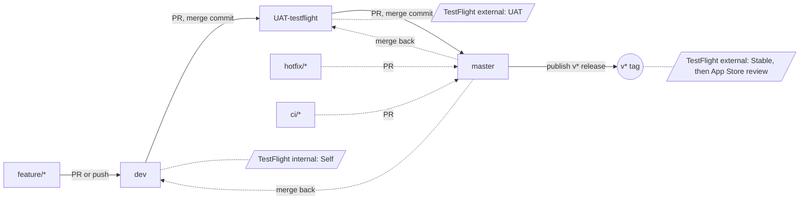

# Pipeline

How code moves from a feature branch to the App Store, and what you have to do
at each hop.

- [Overview](#overview)
- [Reference](#reference): [branch map](#branch-map), [branch rules](#branch-rules-github-rulesets),
  [versions](#versions), [Xcode versions](#xcode-versions),
  [Xcode Cloud workflows](#xcode-cloud-workflows), [PR builds](#pr-builds)
- [Procedures](#procedures): [starting work](#starting-work),
  [`feature/*` → `dev`](#feature--dev), [`dev` → `UAT-testflight`](#dev--uat-testflight),
  [`UAT-testflight` → `master`](#uat-testflight--master), [hotfixes](#hotfixes),
  [CI maintenance](#ci-maintenance)
- [Troubleshooting](#troubleshooting)
- [TestFlight notes](#testflight-notes)
- [Roadmap](#roadmap)

---

## Overview



Direction is always `feature/*` → `dev` → `UAT-testflight` → `master`. Nothing
skips a step except a [hotfix](#hotfixes) or [CI maintenance](#ci-maintenance);
both branch off `master` and are merged back down afterwards.

App builds run on **Xcode Cloud**. GitHub Actions only does repo housekeeping:
`claude.yml` (the `@claude` mention bot), `swiftlint.yml` (lint),
`pr-title.yml` (Conventional Commits PR titles), `promotion-source.yml` (guards
what can merge into `master`) and `testflight-pr.yml` (asks Xcode Cloud to
build a PR on request, see [PR builds](#pr-builds)). If an app build runs, Xcode
Cloud ran it. Trigger details for each workflow are in
[.github/workflows/README.md](.github/workflows/README.md).

---

## Reference

### Branch map

| Branch or ref | Automatic start | TestFlight |
|---|---|---|
| PR targeting `dev` | Swift-file changes start an internal archive and can also start tests for matching source prefixes | Internal → **Self** |
| `dev` | Swift-file changes on the branch | Internal → **Self** |
| `UAT-testflight` | Swift-file changes on the branch | External → **UAT** |
| `v*` tag | Tag changes. Publish the release tag from `master` | External → **Stable** |

See [Xcode Cloud workflows](#xcode-cloud-workflows) for the full triggers and
build environments, and [PR builds](#pr-builds) for on-demand archives.

### Branch rules (GitHub rulesets)

| Branch | Direct push | PR required | Merge method | Other |
|---|---|---|---|---|
| `dev` | ✅ | no | any | no force-push, no deletion |
| `UAT-testflight` | ❌ | yes | merge commit only | no force-push, no deletion |
| `master` | ❌ | yes, from `UAT-testflight`, `hotfix/*` or `ci/*` | merge commit only | `source-branch` check must pass; no force-push, no deletion |
| `v*` tags | — | — | — | can't be moved or deleted once created |

Approvals required: 0 (you can't approve your own PR). Head branches are
auto-deleted after merge; the long-lived branches are protected from that.

**Why merge commits only:** a promotion PR from `dev` into `UAT-testflight`
must carry `dev`'s actual commits. Squashing creates a new commit with the same
content but different history, so the branches drift apart and the next
promotion conflicts.

**Land an app change once.** Make it on `dev` and promote it. Opening matching PRs
into `dev` and `master` is what caused the earlier drift.

The `source-branch` check remains required by the `master` ruleset. Full
retirement is tracked in #164 and requires removing that live status
requirement before deleting the workflow.

### Versions

Two numbers, two jobs:

| Setting | Shows as | Who sets it |
|---|---|---|
| `MARKETING_VERSION` | `1.2.3` | you, by hand on `dev` — or the tag, on `master` |
| `CURRENT_PROJECT_VERSION` | the `(4)` | CI, automatically, always |

App Store Connect only needs each **(version, build)** pair to be unique, so the
build number can restart for each new version. CI sets it to Xcode Cloud's
counter minus `ci_scripts/build_number_offset`:

- The counter is shared by every workflow and only goes up, so `dev` and
  `UAT-testflight` can never produce the same number.
- When you bump `MARKETING_VERSION`, set the offset **in the same commit** to
  the counter's current value: Xcode Cloud → Settings → Build Number shows the
  *next* number, so use that minus one. The new version's builds then start
  near 1.
- If the offset is too high (the result would be 0 or less) or isn't a whole
  number, the build fails straight away with a message saying so.
- Don't reuse a version that already has uploads. 0.1 already has builds up to
  the 50s and 1.0 has builds 6–8, so the first version under this scheme
  should be 0.2 or 1.1.

Use ordinary semver for `MARKETING_VERSION`. Patch for fixes, minor for
features, major when it's a big deal. Don't roll over at 9 — `1.0.14` is
perfectly legal.

`dev` and `UAT-testflight` builds show whatever `MARKETING_VERSION` is set in
the project, so bump it at the *start* of a cycle, not the end.

**Release tags.** On `master` the tag *is* the version:
`ci_scripts/ci_pre_xcodebuild.sh` reads `v1.2.3` and stamps
`MARKETING_VERSION = 1.2.3` into the build. Tag format is 1–3 dot-separated
integers after the `v`. `v1.2.3`, `v1.2` and `v2` are all fine. `v1.0.0.1` and
`v2.0-beta` are rejected and the build fails immediately rather than at upload.

**Lane stamp.** The Settings screen footer shows `lane · build time (AEST/AEDT) · version (build)`.
CI stamps the branch or tag as `StudyAppLane` and Sydney build time as
`StudyAppBuildTime` into Info.plist; local builds show `local`. Never hardcode
branch-specific values in source — it makes every promotion conflict.

### Xcode versions

**Latest Release** follows Apple's current selection. `UAT-testflight` pins
Xcode to 26.6. The workflow table below lists Xcode and Clean settings.

The Xcode version is separate from the oldest iOS the app supports
(`IPHONEOS_DEPLOYMENT_TARGET`, currently 26.0). Always build with a recent
Xcode; support older iOS by lowering the deployment target and guarding newer
APIs with `if #available(iOS 26, *)`.

> The Xcode Cloud settings in this file (pins, start conditions, clean builds,
> the build counter) live in App Store Connect and can't be checked from the
> repo. Re-check them there when changing a workflow.

### Xcode Cloud workflows

All six workflows below were enabled in
[App Store Connect](https://appstoreconnect.apple.com/teams/e08757ec-22cd-4952-b6de-e307fd6f1fc8/xcode-cloud/products/C4F54545-E295-4304-A95E-3B9BF44E1F39/workflows)
when reviewed on 23–24 November 2026. All use **Latest Release** for macOS.

| Workflow | Start condition | Xcode / Clean | iOS action and distribution |
|---|---|---|---|
| `dev testflight` | Branch Changes on `dev`, Swift-file filter, auto-cancel on | Latest Release / off | Internal TestFlight archive → **Self** |
| `Master Change` | Tag Changes for tags beginning with `v`, any file changes, auto-cancel on | Latest Release / on | App Store Connect archive → external TestFlight **Stable**. Submit for App Store review separately |
| `PR TestFlight` | Manual Start on any branch. Manual PR and tag starts are disabled | Latest Release / off | Internal TestFlight archive → **Self** |
| `Targeting Dev PR` | Pull Request Changes from any source branch into `dev`, Swift-file filter, auto-cancel on | Latest Release / on | Internal TestFlight archive → **Self** |
| `test /feat & /refactor branches` | Pull Request Changes from branches beginning with `feat` or `refactor` into `dev`, Swift-file filter, auto-cancel on | Latest Release / on | Test using the `studyApp` scheme settings. The action must pass. No distribution post-action |
| `UAT-testflight` | Branch Changes on `UAT-testflight`, Swift-file filter, auto-cancel on | 26.6 (17F113) / on | App Store Connect archive → external TestFlight **UAT** |

App Store Connect displays the Swift-file filter as file type `swift` with a
blank folder. A matching `feat` or `refactor` PR into `dev` can start both an
internal archive and a separate test run. The test action's **Required to Pass**
setting applies to that Xcode Cloud workflow. Current-head results and GitHub
required-check coverage remain tracked in #186.

### PR builds

Put `/testflight` on its own line (any case) in an open PR's description or
in a comment from an owner, member or collaborator. This requests a build
independently of the automatic `Targeting Dev PR` workflow.

`testflight-pr.yml` calls the App Store Connect API with the workflow named by
`XCODE_CLOUD_PR_WORKFLOW`, which defaults to **PR TestFlight**.

| GitHub event | Script revision | Build requested |
|---|---|---|
| New PR comment | Default branch (`master`) | The PR's head branch. This matches the default workflow's manual branch setting |
| PR opened, reopened or description changed | PR merge ref | The starter on `dev` requests a PR-associated build. The starter on `master` and `UAT-testflight` requests a head-branch build. The PR's changes can also affect the script on the merge ref |

The default **PR TestFlight** workflow has manual PR starts disabled. A
PR-associated request requires a workflow that allows manual PR starts.
The repository variable, if set, can select a different workflow.

- To request another on-demand build after adding commits, post a fresh
  `/testflight` comment.
- The Action accepts open, same-repository PRs.
- The Action uses `APP_STORE_CONNECT_KEY_ID`, `APP_STORE_CONNECT_ISSUER_ID` and
  `APP_STORE_CONNECT_PRIVATE_KEY`.
- The source checkout must contain `ci_scripts/` for the build hooks to run.

---

## Procedures

The two promotions have PR templates with these checklists built in. Open the
PR with the template already filled in:

- `dev` → `UAT-testflight`: [compare `dev` into `UAT-testflight` with `promote-to-uat.md`](https://github.com/bradwils/studyApp/compare/UAT-testflight...dev?expand=1&template=promote-to-uat.md)
- `UAT-testflight` → `master`: [compare `UAT-testflight` into `master` with `release.md`](https://github.com/bradwils/studyApp/compare/master...UAT-testflight?expand=1&template=release.md)

### Starting work

Branch app work off `dev`. Hotfixes and CI maintenance branch off `master`:

```sh
git checkout dev
git pull
git checkout -b feat/my-feature
```

A Swift-file change in a PR targeting `dev` can start an automatic internal
TestFlight archive. Matching source prefixes can also trigger tests. See
[PR builds](#pr-builds) for on-demand builds.

### `feature/*` → `dev`

Open a PR targeting `dev` (or push straight to `dev` for small changes).

Before you merge:

- [ ] Build locally at least once. SwiftLint runs on PRs into every long-lived
  branch (and on pushes to `dev`) — errors fail it, warnings are only
  annotated. Review the current Xcode Cloud build/test result where configured;
  lint alone does not verify compilation or unit tests.
- [ ] PR title follows Conventional Commits (`type(scope): description`). The
  `PR title` check enforces it on PRs targeting any branch, because merge
  commits take the PR title.
- [ ] If this is the first change of a new release cycle, bump
  `MARKETING_VERSION` and the build number offset in the same commit. See
  [Versions](#versions).

A merge matching the Swift-file filter starts an internal build for **Self**.

### `dev` → `UAT-testflight`

Open a PR from `dev` targeting `UAT-testflight`, and merge it with **Create a
merge commit**.

This is the promotion that matters, because the build goes out to people who
aren't you. Before merging:

- [ ] Install the current `dev` build from TestFlight and actually open it.
- [ ] Check that `MARKETING_VERSION` is the version you intend testers to see.
- [ ] Preview the generated [TestFlight notes](#testflight-notes) for the
  destination lane and provide testing instructions in the PR.

A merge matching the Swift-file filter starts an external build for **UAT**.

### `UAT-testflight` → `master`

Open a PR from `UAT-testflight` targeting `master`, and merge it with **Create
a merge commit**. The `source-branch` check rejects a PR from anything other
than `UAT-testflight`, `hotfix/*` or `ci/*`. The latter two are exceptions for
production fixes and CI maintenance, respectively.

The release workflow starts when a tag beginning with `v` changes. An
eligible PR can request an internal build before it merges.

To cut the release, publish a GitHub Release:

1. GitHub → Releases → **Draft a new release**
2. **Choose a tag** → type `v1.2.3` → *Create new tag on publish*
   ([format](#versions))
3. **Target**: `master`
4. **Generate release notes** (lists the merged PRs), then **Publish release**

Publishing creates the tag, and the tag starts the Xcode Cloud build.

Always target `master`. Xcode Cloud builds a `v*` tag on whatever commit it
points at, so a tag on `dev` would ship unreleased work.

### Hotfixes

A production bug shouldn't have to travel the whole chain. Branch off `master`
with a `hotfix/` name, fix, PR into `master`, then release:

```sh
git checkout master && git pull
git checkout -b hotfix/crash-on-launch
# fix, commit, push, PR into master, merge with a merge commit
```

Then publish a GitHub Release for `v1.2.4` targeting `master`, and merge
`master` back into `dev` so the next release doesn't silently revert the fix:

```sh
git checkout dev && git pull
git merge origin/master
git push
```

### CI maintenance

For CI, tooling or documentation changes that need to reach the default branch
without promoting app work, cut a `ci/*` branch from `master` and open a PR into
`master`. Merge with **Create a merge commit**. The `source-branch` check accepts
the prefix; keeping the change limited to maintenance is a review convention,
not a changed-file restriction.

After merging, merge `master` into `UAT-testflight` through a merge-commit PR
and back into `dev`, preserving each target's current changes. This carries the
same commits through all lanes. The Swift-file filters on `dev` and
`UAT-testflight` still apply. CI-only changes can land without a release tag.

---

## Troubleshooting

**A build fails straight away on a missing or wrong script.** `ci_scripts/`
must exist on every branch that builds. Xcode Cloud reads it from the branch
being built, not from `master`.

**A workflow builds when you didn't expect it to.** Start conditions are OR'd,
not AND'd. A workflow with both "Branch Changes" and "Tag Changes" builds on
*either*. `Master Change` has only the tag condition.

**A Save button spins forever in the Xcode Cloud workflow editor.** The App
Store Connect sign-in has lapsed — the real error is only in the browser
console. Reload, sign in, and redo the edit.

**The build fails immediately on a release tag.** The tag isn't 1–3
dot-separated integers after the `v`. See [Versions](#versions).

**The build fails immediately on the build number.** `build_number_offset` is
too high or isn't a whole number. See [Versions](#versions).

**An on-demand build fails to start.** Check the GitHub Actions run summary.
Confirm which ref supplied the starter and whether the selected workflow allows
that manual start type. See [PR builds](#pr-builds).

---

## Roadmap

Known gaps, in rough priority order:

1. **Verify Xcode Cloud unit-test coverage** (#186). A feature/refactor PR test
   workflow is configured. Verify current-head results, trigger coverage,
   result visibility and required statuses before completing runner migration.
2. UI tests are slow and flaky per PR. Run them on a nightly schedule against
   `UAT-testflight` instead.
3. **Verify generated TestFlight notes in Apple** after rollout (#203). Git
   history is generated automatically; testing instructions still belong in
   the PR. GitHub Release notes serve a different purpose.
4. Retire the `source-branch` check and `promotion-source.yml` (#164).

---

## TestFlight notes

Xcode Cloud generates `TestFlight/WhatToTest.en-US.txt` from Git history and
build metadata. No release-cycle JSON, manual summaries or promotion entries
are required. Commit titles, including merge commits, appear directly in the
notes, so write them clearly. No GitHub token, App Store Connect key, AI service
or additional package is needed for note generation. The scripts must reach
each building branch before that branch can generate notes.

### Contents and commit range

Each build includes its version, build number, branch/tag, full checkout commit
SHA, UTC timestamp and Sydney display time (AEST/AEDT). When Xcode Cloud supplies
both PR branch variables, the branch preview shows the PR source and target at
build time. It does not attempt to reconstruct branch origins or promotions.

Commit titles are listed newest first, with abbreviated SHAs. A target range
means all commits reachable from the build that are not reachable from the
target (`git log TARGET..BUILD`), including merged feature history. Shared
history and target-only commits are excluded. This is a comparison of commit
ancestry, not a file diff or the exact date a branch was originally created.
Rebased or cherry-picked equivalents can appear because their SHAs differ.
If the target already contains the entire build, the notes explicitly report
that there are no unique commits.

The target is selected in this order:

1. `--target BRANCH`, for local commands.
2. The `TESTFLIGHT_TARGET_BRANCH` workflow environment variable.
3. Xcode Cloud's `CI_PULL_REQUEST_TARGET_BRANCH`, when available. Its
   `CI_PULL_REQUEST_TARGET_COMMIT` pins the comparison snapshot when provided.
4. These lane defaults:

| Build location | Comparison |
|---|---|
| `dev` | Commits not yet in `UAT-testflight` |
| `UAT-testflight` | Commits not yet in `master` |
| `ci/*`, `hotfix/*` | Commits not yet in `master` |
| Other feature branches | Commits not yet in `dev` |
| `master` or a tag | Since the nearest earlier reachable `v*` version tag |

For master/tag builds, tags on the build's own commit are excluded from baseline
selection, so rebuilding a release still shows its changes. If there is no
earlier version tag, the notes explicitly use all reachable history.

The PR-associated starter finds the PR in Xcode Cloud's primary repository
before requesting a build. The selected workflow must allow manual PR starts.
If Apple cannot find the PR, the request fails. See [PR builds](#pr-builds)
for the starter used by each event.
PR notes include the PR link when supplied by Xcode Cloud. The comparison uses
the PR source and target commit snapshots supplied to the build, when available;
these can differ from the current PR page after further pushes. The PR source
must be part of the checkout. Branch and UAT builds without PR metadata use the
lane defaults above and omit the PR preview. `TESTFLIGHT_TARGET_BRANCH` can
override the comparison target. Commit titles are not written testing steps;
consult the PR for testing guidance.

### Reading a build's notes

The first lines of the notes say what was built:

- **Branch/tag** is the lane label: for PR builds, the PR's source branch, not
  its target. The checkout may be a temporary merge commit. The `Comparison`
  line names the comparison target (`TARGET..build`).
- **Comparison** shows what the commit list is measured against. `dev..build`
  means commits not yet in `dev`; `master..build` means not yet in `master`.
- **Commit** is the full checkout SHA that was built; a temporary merge commit
  can differ from the PR head. **PR source commit**, when shown, identifies the
  source snapshot included in that checkout. Compare that with the PR head.

How to tell the kind of build apart:

| Build | Notes show |
|---|---|
| Branch or tag build, including a branch-based `/testflight` request | Lane-default comparison |
| Automatic or on-demand PR build with PR metadata | PR link when available, and the PR target as the default comparison |

In stacked PRs, a successful `/testflight` request on each PR starts a
separate build. Compare the Branch/tag and Commit lines to identify the
source of a build.

### Generation and storage

Before archive builds, `ci_pre_xcodebuild.sh` stamps the version,
build number and lane, fetches origin's branches/tags and completes shallow Git
history. Missing targets, unrelated histories or fetch failures stop generation
with an explicit error rather than silently describing incomplete history.
Only the build checkout's Git refs/history are updated; nothing is committed or
pushed back to the repository.

The pre-build hook saves an ignored `TestFlight/build-metadata.json` snapshot,
including the selected commit titles and available PR details. One timestamp is
used for that snapshot and `StudyAppBuildTime` in the app's Info.plist. This
keeps the history range stable between pre-build and post-build even if remote
branches move. The `TestFlight/` folder is created automatically when needed.

The post-build hook writes `TestFlight/WhatToTest.en-US.txt` only when
`CI_APP_STORE_SIGNED_APP_PATH` is a directory, following Apple's documented
[TestFlight notes mechanism](https://developer.apple.com/documentation/xcode/including-notes-for-testers-with-a-beta-release-of-your-app).
Test/analyze actions do not produce the notes file. Generation rejects metadata
from a different checkout commit. Metadata and notes are ignored by Git and are
not app resources. The generated notes also appear in the post-build log and
are shared with everyone who can access the TestFlight build.

Notes retain the project's conservative 3,500-character budget, counting UTF-16
units so emoji are accounted for conservatively. If the history is too long,
older commit lines are omitted and the footer reports how many commits are
shown. An oversized newest title is shortened with an ellipsis. Build identity
and timestamps are preserved; history length does not fail the build.

### Verification without an app build

From the repository root:

```sh
python3 ci_scripts/testflight_notes.py preview --version 0.3 --build 24 --lane UAT-testflight
python3 ci_scripts/testflight_notes.py preview --target dev
python3 -m unittest discover -s ci_scripts -p 'test*.py'
zsh -n ci_scripts/ci_pre_xcodebuild.sh ci_scripts/ci_post_xcodebuild.sh
```

Preview prints to stdout without creating files or accessing the network.
Use `--fetch` to refresh origin refs and complete shallow history explicitly.
Without it, preview uses the available local refs, preferring `origin/BRANCH`
over a local branch. Python 3.9+ with the standard library and Sydney timezone
data is required. Fixture checks use temporary local Git repositories and do
not compile Swift or contact any service. The archive-hook integration fixture
requires macOS (`sed`, PlistBuddy and zsh); portable fixtures still run on Linux.

After an app build is explicitly authorized, inspect its Xcode Cloud post-build
log and TestFlight's “What to Test” field. Confirm the version/build, branch/tag,
full commit, timestamps, comparison range and commit titles match the upload.
This service-side check cannot be proven by local fixtures.
