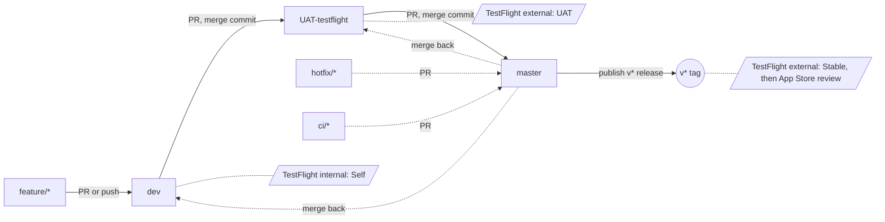

# Pipeline

How code moves from a feature branch to the App Store, and what you have to do
at each hop.

- [Overview](#overview)
- [Reference](#reference): [branch map](#branch-map), [branch rules](#branch-rules-github-rulesets),
  [versions](#versions), [Xcode versions](#xcode-versions), [PR builds](#pr-builds)
- [Procedures](#procedures): [starting work](#starting-work),
  [`feature/*` → `dev`](#feature--dev), [`dev` → `UAT-testflight`](#dev--uat-testflight),
  [`UAT-testflight` → `master`](#uat-testflight--master), [hotfixes](#hotfixes),
  [CI maintenance](#ci-maintenance)
- [Troubleshooting](#troubleshooting)
- [Roadmap](#roadmap)

---

## Overview



Direction is always `feature/*` → `dev` → `UAT-testflight` → `master`. Nothing
skips a step except a [hotfix](#hotfixes) or [CI maintenance](#ci-maintenance);
both branch off `master` and are merged back down afterwards.

App builds run on **Xcode Cloud**. GitHub Actions only does repo housekeeping:
`claude.yml` (the `@claude` mention bot), `swiftlint.yml` (lint),
`pr-title.yml` (Conventional Commits PR titles), `promotion-source.yml` (guards
what can merge into `master`) and `testflight-pr.yml` (asks Xcode Cloud to
build a PR on request, see [PR builds](#pr-builds)). If an app build runs, Xcode
Cloud ran it. Trigger details for each workflow are in
[.github/workflows/README.md](.github/workflows/README.md).

---

## Reference

### Branch map

| Branch | Holds | Builds when | Lands in | Xcode |
|---|---|---|---|---|
| `feature/*` | work in progress | never (unless [requested](#pr-builds)) | nowhere | — |
| `dev` | integrated, unverified | every push | TestFlight internal → **Self** | Latest Release |
| `UAT-testflight` | ready to test, may be rough | every push | TestFlight external → **UAT** | pinned (26.6) |
| `master` | shipped | `v*` tag only | TestFlight external → **Stable**, then App Store review | pinned (26.6) |

The **UAT** and **Stable** groups have no testers yet — builds land there and
wait. Add testers in App Store Connect → TestFlight when testing starts.

### Branch rules (GitHub rulesets)

| Branch | Direct push | PR required | Merge method | Other |
|---|---|---|---|---|
| `dev` | ✅ | no | any | no force-push, no deletion |
| `UAT-testflight` | ❌ | yes | merge commit only | no force-push, no deletion |
| `master` | ❌ | yes, from `UAT-testflight`, `hotfix/*` or `ci/*` | merge commit only | `source-branch` check must pass; no force-push, no deletion |
| `v*` tags | — | — | — | can't be moved or deleted once created |

Approvals required: 0 (you can't approve your own PR). Head branches are
auto-deleted after merge; the long-lived branches are protected from that.

**Why merge commits only:** a promotion PR from `dev` into `UAT-testflight`
must carry `dev`'s actual commits. Squashing creates a new commit with the same
content but different history, so the branches drift apart and the next
promotion conflicts.

**Land an app change once.** Make it on `dev` and promote it. Opening matching PRs
into `dev` and `master` is what caused the earlier drift.

The `source-branch` check remains required by the `master` ruleset. Full
retirement is tracked in #164 and requires removing that live status
requirement before deleting the workflow.

### Versions

Two numbers, two jobs:

| Setting | Shows as | Who sets it |
|---|---|---|
| `MARKETING_VERSION` | `1.2.3` | you, by hand on `dev` — or the tag, on `master` |
| `CURRENT_PROJECT_VERSION` | the `(4)` | CI, automatically, always |

App Store Connect only needs each **(version, build)** pair to be unique, so the
build number can restart for each new version. CI sets it to Xcode Cloud's
counter minus `ci_scripts/build_number_offset`:

- The counter is shared by every workflow and only goes up, so `dev` and
  `UAT-testflight` can never produce the same number.
- When you bump `MARKETING_VERSION`, set the offset **in the same commit** to
  the counter's current value: Xcode Cloud → Settings → Build Number shows the
  *next* number, so use that minus one. The new version's builds then start
  near 1.
- If the offset is too high (the result would be 0 or less) or isn't a whole
  number, the build fails straight away with a message saying so.
- Don't reuse a version that already has uploads. 0.1 already has builds up to
  the 50s and 1.0 has builds 6–8, so the first version under this scheme
  should be 0.2 or 1.1.

Use ordinary semver for `MARKETING_VERSION`. Patch for fixes, minor for
features, major when it's a big deal. Don't roll over at 9 — `1.0.14` is
perfectly legal.

`dev` and `UAT-testflight` builds show whatever `MARKETING_VERSION` is set in
the project, so bump it at the *start* of a cycle, not the end.

**Release tags.** On `master` the tag *is* the version:
`ci_scripts/ci_pre_xcodebuild.sh` reads `v1.2.3` and stamps
`MARKETING_VERSION = 1.2.3` into the build. Tag format is 1–3 dot-separated
integers after the `v`. `v1.2.3`, `v1.2` and `v2` are all fine. `v1.0.0.1` and
`v2.0-beta` are rejected and the build fails immediately rather than at upload.

**Lane stamp.** The Settings screen footer shows `lane · version (build)`. CI
stamps the lane (branch or tag name) into Info.plist as `StudyAppLane`; local
builds show `local`. Never hardcode branch-specific values in source — it makes
every promotion conflict.

### Xcode versions

`dev` builds with **Latest Release**, so a new Xcode shows up there first.
`UAT-testflight` and `master` are pinned to a known-good version. Once `dev` has
built cleanly on a new Xcode, move the pins up in each workflow's Environment
settings.

`master` and `UAT-testflight` build clean for reproducibility. `dev` reuses
caches for speed.

The Xcode version is separate from the oldest iOS the app supports
(`IPHONEOS_DEPLOYMENT_TARGET`, currently 26.0). Always build with a recent
Xcode; support older iOS by lowering the deployment target and guarding newer
APIs with `if #available(iOS 26, *)`.

> The Xcode Cloud settings in this file (pins, start conditions, clean builds,
> the build counter) live in App Store Connect and can't be checked from the
> repo. Re-check them there when changing a workflow.

### PR builds

Feature branches don't build on their own. To get one onto your phone, put
`/testflight` on its own line (any case) in the PR description, or in a comment
on the PR (owner, members and collaborators only).

`testflight-pr.yml` then calls the App Store Connect API and starts a build of
the PR's head branch on the Xcode Cloud workflow named **PR TestFlight**
(override with the repo variable `XCODE_CLOUD_PR_WORKFLOW`). That workflow
archives and distributes to the internal TestFlight group. Because the build is
started on the branch itself, the Settings footer shows the real branch name,
the build time in Sydney time, and the usual version (build).

- Triggers: PR opened/reopened, PR description edited (only if the body
  changed), or a new comment. Pushes do not rebuild; comment `/testflight`
  again.
- **Comment activation:** GitHub runs `issue_comment` workflows from the default
  branch (`master`). Having this workflow on `dev` alone does not activate
  `/testflight` comments; promote it to `master` before relying on comment
  triggers.
- Fork PRs and closed PRs are skipped; only open PRs from this repository can build.
- Uses the secrets `APP_STORE_CONNECT_KEY_ID`, `APP_STORE_CONNECT_ISSUER_ID`
  and `APP_STORE_CONNECT_PRIVATE_KEY`.
- **One-off setup in Xcode:** create a workflow called `PR TestFlight` whose only
  start condition is **Manual Start** for *all branches* (Apple refuses an
  API-started build on a branch the workflow doesn't list, and a Branch Changes
  condition would build every push), a TestFlight Internal
  Testing post-action (distribute to **Self**), and the same environment as
  `dev`. The workflow must run `ci_scripts/`, so the PR's branch has to include
  that folder.

---

## Procedures

The two promotions have PR templates with these checklists built in. Open the
PR with the template already filled in:

- `dev` → `UAT-testflight`: [compare `dev` into `UAT-testflight` with `promote-to-uat.md`](https://github.com/bradwils/studyApp/compare/UAT-testflight...dev?expand=1&template=promote-to-uat.md)
- `UAT-testflight` → `master`: [compare `UAT-testflight` into `master` with `release.md`](https://github.com/bradwils/studyApp/compare/master...UAT-testflight?expand=1&template=release.md)

### Starting work

Branch app work off `dev`. Hotfixes and CI maintenance branch off `master`:

```sh
git checkout dev
git pull
git checkout -b my-feature
```

Push freely. Feature branches don't build, so nothing is watching and nothing
is spent.

### `feature/*` → `dev`

Open a PR targeting `dev` (or push straight to `dev` for small changes).

Before you merge:

- [ ] Build locally at least once. SwiftLint runs on PRs into every long-lived
  branch (and on pushes to `dev`) — errors fail it, warnings are only
  annotated — but nothing builds or runs tests, so a compile error reaches
  TestFlight before anyone notices.
- [ ] PR title follows Conventional Commits (`type(scope): description`). The
  `PR title` check enforces it on PRs into `dev`, because merge commits take
  the PR title.
- [ ] If this is the first change of a new release cycle, bump
  `MARKETING_VERSION` and the build number offset in the same commit. See
  [Versions](#versions).

On merge, `dev` builds and lands in the **Self** TestFlight group.

### `dev` → `UAT-testflight`

Open a PR from `dev` targeting `UAT-testflight`, and merge it with **Create a
merge commit**.

This is the promotion that matters, because the build goes out to people who
aren't you. Before merging:

- [ ] Install the current `dev` build from TestFlight and actually open it.
- [ ] Check that `MARKETING_VERSION` is the version you intend testers to see.
- [ ] Write TestFlight "What to Test" notes — this is the only place a tester
  learns what changed.

On merge, `UAT-testflight` builds and goes to the **UAT** group. Every push
here builds, so merge once, deliberately.

### `UAT-testflight` → `master`

Open a PR from `UAT-testflight` targeting `master`, and merge it with **Create
a merge commit**. The `source-branch` check rejects a PR from anything other
than `UAT-testflight`, `hotfix/*` or `ci/*`. The latter two are exceptions for
production fixes and CI maintenance, respectively.

**Merging does not build anything.** `master` only builds on a version tag.
That's deliberate: merging and releasing are separate decisions.

To cut the release, publish a GitHub Release:

1. GitHub → Releases → **Draft a new release**
2. **Choose a tag** → type `v1.2.3` → *Create new tag on publish*
   ([format](#versions))
3. **Target**: `master`
4. **Generate release notes** (lists the merged PRs), then **Publish release**

Publishing creates the tag, and the tag starts the Xcode Cloud build.

Always target `master`. Xcode Cloud builds a `v*` tag on whatever commit it
points at, so a tag on `dev` would ship unreleased work.

### Hotfixes

A production bug shouldn't have to travel the whole chain. Branch off `master`
with a `hotfix/` name, fix, PR into `master`, then release:

```sh
git checkout master && git pull
git checkout -b hotfix/crash-on-launch
# fix, commit, push, PR into master, merge with a merge commit
```

Then publish a GitHub Release for `v1.2.4` targeting `master`, and merge
`master` back into `dev` so the next release doesn't silently revert the fix:

```sh
git checkout dev && git pull
git merge origin/master
git push
```

### CI maintenance

For CI, tooling or documentation changes that need to reach the default branch
without promoting app work, cut a `ci/*` branch from `master` and open a PR into
`master`. Merge with **Create a merge commit**. The `source-branch` check accepts
the prefix; keeping the change limited to maintenance is a review convention,
not a changed-file restriction.

After merging, merge `master` into `UAT-testflight` through a merge-commit PR
and back into `dev`, preserving each target's current changes. This carries the
same commits through all lanes. UAT and dev still build on push; no release tag
is needed for a CI-only change.

---

## Troubleshooting

**A build fails straight away on a missing or wrong script.** `ci_scripts/`
must exist on every branch that builds. Xcode Cloud reads it from the branch
being built, not from `master`.

**A workflow builds when you didn't expect it to.** Start conditions are OR'd,
not AND'd. A workflow with both "Branch Changes" and "Tag Changes" builds on
*either*. That's why `master` has only the tag condition.

**A Save button spins forever in the Xcode Cloud workflow editor.** The App
Store Connect sign-in has lapsed — the real error is only in the browser
console. Reload, sign in, and redo the edit.

**The build fails immediately on a release tag.** The tag isn't 1–3
dot-separated integers after the `v`. See [Versions](#versions).

**The build fails immediately on the build number.** `build_number_offset` is
too high or isn't a whole number. See [Versions](#versions).

**`/testflight` in a comment does nothing.** `testflight-pr.yml` has to be on
`master` for comment triggers. See [PR builds](#pr-builds).

---

## Roadmap

Known gaps, in rough priority order:

1. **No tests run anywhere.** The unit tests were rewritten against SwiftData
   (`AppSessionTests`, `StudySessionTests`; see #135), but no workflow runs
   them. Add an Xcode Cloud workflow that starts on pull requests into `dev`,
   `UAT-testflight` and `master`, builds and runs unit tests (no archive, no
   distribution), and make it a required check in the rulesets.
2. UI tests are slow and flaky per PR. Run them on a nightly schedule against
   `UAT-testflight` instead.
3. TestFlight "What to Test" notes are written by hand. A `ci_post_clone.sh`
   could generate `TestFlight/WhatToTest.en-US.txt` from the git log.
4. Retire the `source-branch` check and `promotion-source.yml` (#164).
